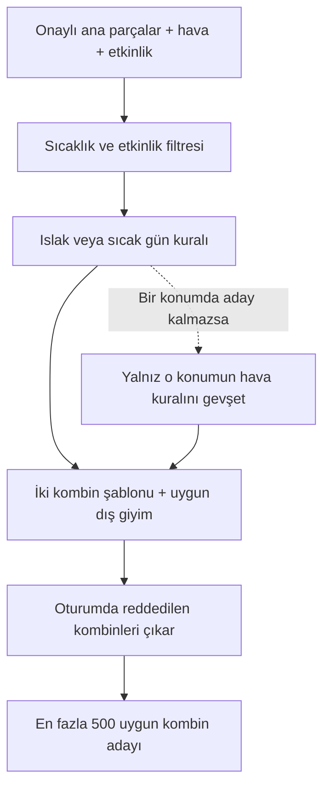

# E1 · Aday üretimi ve ortak filtreleme raporu

## Durum

E1'in yerel uygulaması ve davranış testleri tamamlandı. Ekip teyitleri ve C#
entegrasyonu tamamlanmadığı için bu kayıt, uçtan uca teslim onayı anlamına gelmez.
E2 renk puanlaması, E3/E4 öğrenme, E10 simülasyonu ve servis uçları henüz eklenmedi.
E1 aday havuzu üretir; renk puanlaması veya kullanıcı tercihine göre kart seçimi yapmaz.

E1 çalışması tamamlanıp ayrı bir commit olarak kaydedildikten sonra E2'ye geçilecek.

## İşleyiş



Şablonlar `üst + alt + ayakkabı` ve `tek parça + ayakkabı` şeklindedir.
Uygun dış giyim varsa her kombine bir dış giyim eklenir. Yedek kural, sıcaklık,
etkinlik veya tekrar engelini kaldırmaz. Çıktı puanlanmamış aday havuzudur.

## Kaynak ve uygulanan kapsam

- DolabımAI Geliştirme Planı: öneri motoru görevleri (s. 28–30), ortak öneri kuralları
  ve güncellenmiş sorumluluklar.
- DolabımAI Proje Planı: görüntü analizi/öneri ayrımı ve araştırma amacı.
- DolabımAI 1. Aşama Planı: E1 ve D5 açıklamaları; T-35/T-36 senaryoları.
- [api PR #1](https://github.com/DolabimAI/api/pull/1),
  `4192139`: kategori, alt tür, renk, ton ve hava verileri.
- CSV'deki 35 alt tür, 13 renk ve 3 ton, PR'daki listelerle sıraları dahil eşleşti.
- Test dolabı 35 sentetik parça içerir; gerçek kullanıcı verisi içermez.

İki ana şablon, sıcaklık/etkinlik filtresi, dış giyim ekleme, ıslak/sıcak gün yedekleri,
oturum içi tekrar engeli ve sınırlı aday üretimi uygulandı. Model, renk puanı veya
FastAPI entegrasyonu bu değişikliğe dahil değil.

## Başlangıç değerleri ve nedenleri

- Python 3.12, yerel `.venv`; E1 için harici paket yok.
- Sıcak gün eşiği: 25 °C ve güneşli hava. Kaynak: aşama planı.
- Aday sınırı: 500, ayar dosyasında. Büyüyen kartezyen çarpımı belleğe almamak ve
  sonraki yöntemlerin puanlayacağı aday sayısını sınırlamak için başlangıç tercihi.
  Süre hedeflerine göre daha sonra ölçülüp değiştirilebilir.
- Demo/test tohumu: 42. Motor çağrısı sabit tohum zorunlu tutmaz.
- Sınırlı aday üretiminde rastgele başlangıç ve kombin sayısıyla aralarında asal adım
  kullanılıyor. Her indeks en fazla bir kez görülür. Eşit olasılıklı alt küme örneklemesi
  iddiası yok; sentetik karşılaştırmada iki yöntem mutlaka aynı havuzu kullanmalı.
- Reddedilen kombin, sıralanmış ana parça id'leriyle tanımlanır. Dış giyim dahildir;
  aksesuarlar ayrı aşamada ele alınır. Ret listesi çağrıya özeldir, global durumda tutulmaz.

## Belgelerdeki belirsizlik için seçilen yorum

Yağmura uygun bir dış giyim sıcaklık/etkinlikten elendiyse geri alınmaz. Sıcaklık ve
etkinlik sabit kısıttır; yedek yalnız hava filtresini gevşetir. Böylece 0 °C'de alt sınırı
5 °C olan yağmurluk eklenmez. Hiç uygun dış giyim yoksa ana şablon dış giyimsiz döner.
Bu yorum ekip tarafından onaylanmış karar olarak sunulmuyor.

## Doğrulama sonuçları

| Kontrol                 | Sonuç                                                                             |
| ----------------------- | --------------------------------------------------------------------------------- |
| Birim testleri          | 30 test geçti; 0 başarısızlık, 0 hata                                             |
| Demo senaryoları        | 9 senaryonun tamamı beklenen sonucu verdi                                         |
| Aday içerikleri         | Aşağıdaki ilk 8 senaryoda bütün kombin kimlik kümeleri beklenen kümelerle eşleşti |
| Tekrarlı aday           | Karşılaştırılan aday havuzlarında bulunmadı                                       |
| Renk ve ton değişikliği | Kontrol edilen senaryoda aday kimlikleri ve sırası değişmedi                      |
| Örnek dolabın korunması | Silinmiş ayakkabı denemesi geçici kopyada yapıldı; asıl dosya değişmedi           |

### Senaryo karşılaştırması

Sonuçlar [örnek dolap](../tests/sample_wardrobe.json), 500 aday sınırı ve 42 rastgelelik
tohumu kullanılarak elde edildi. Son satırda aynı dolabın bütün ayakkabıları `silindi`
durumuna alınmış geçici kopyası kullanıldı.

| Senaryo                    | Hissedilen | Hava     | Etkinlik | Beklenen aday | Üretilen aday | Sonuç   |
| -------------------------- | ---------: | -------- | -------- | ------------: | ------------: | ------- |
| Varsayılan demo            |      24 °C | Yağmurlu | Günlük   |            25 |            25 | Eşleşti |
| Serin ve yağmurlu          |      10 °C | Yağmurlu | Günlük   |           100 |           100 | Eşleşti |
| Sıcak ve güneşli           |      28 °C | Güneşli  | İş       |            12 |            12 | Eşleşti |
| Karlı                      |       6 °C | Karlı    | Günlük   |           100 |           100 | Eşleşti |
| Sıcaklık aralığı dışında   |      50 °C | Güneşli  | Günlük   |             0 |             0 | Eşleşti |
| Sıcak gün eşiğinin altı    |    24,9 °C | Güneşli  | İş       |            36 |            36 | Eşleşti |
| Sıcak gün eşiği            |      25 °C | Güneşli  | İş       |            12 |            12 | Eşleşti |
| Eşikte, güneşsiz           |      25 °C | Kapalı   | İş       |            36 |            36 | Eşleşti |
| Bütün ayakkabılar silinmiş |      24 °C | Yağmurlu | Günlük   |             0 |             0 | Eşleşti |

İlk 8 senaryoda aday sınırına ulaşılmadı ve hava filtresinin yedek kuralına ihtiyaç
duyulmadı. Sıfır aday bulunan senaryolarda uygun kombin bulunamadığı mesajı gösterildi.

### Beklenen sonuçlar nasıl kontrol edildi?

Demo yalnızca ilk beş adayı yazdırır. Doğrulama sırasında motorun döndürdüğü **bütün
adaylar** incelendi. Örnek dolaptan elle belirlenen uygun parça kimliklerinin
kombinasyonları, motorun filtreleme veya indeksleme kodu kullanılmadan ayrı bir kontrol
betiğinde oluşturuldu. Her kombinin sıralanmış parça id'leri karşılaştırıldı; aday
sayıları ve tekrar bulunmaması da ayrıca kontrol edildi.

Örneğin varsayılan senaryoda uygun parçalar şunlardır:

| Konum     | Uygun parça id'leri | Sayı |
| --------- | ------------------- | ---: |
| Üst       | 1, 2, 7, 8          |    4 |
| Alt       | 9, 10, 14, 15, 16   |    5 |
| Ayakkabı  | 17                  |    1 |
| Tek parça | 29, 30, 31, 32, 33  |    5 |
| Dış giyim | Yok                 |    0 |

Bu senaryoda dış giyim eklenmez. Beklenen sayı:

```text
Üst + alt + ayakkabı: 4 × 5 × 1 = 20
Tek parça + ayakkabı:     5 × 1 =  5
Toplam:                         25 aday
```

25 °C sınırındaki iş senaryosu da ayakkabı kuralını gösterir:

| Bağlam             | Uygun ayakkabılar               | Toplam aday |
| ------------------ | ------------------------------- | ----------: |
| 24,9 °C ve güneşli | Klasik ayakkabı, babet, topuklu |          36 |
| 25 °C ve güneşli   | Babet                           |          12 |
| 25 °C ve kapalı    | Klasik ayakkabı, babet, topuklu |          36 |

Bu farkın nedeni, sıcak gün kuralının yalnız **en az 25 °C ve güneşli** koşulunda
çalışmasıdır. Klasik ayakkabı ve topuklu, bu örnek veride sıcak gün tercih işareti taşımaz.

### Birim testlerinin kapsamı

| Alan                 | Doğrulanan davranış                                                             |
| -------------------- | ------------------------------------------------------------------------------- |
| Aday üretimi         | İki şablon; yalnız onaylı parçalar; aksesuarların dışarıda tutulması            |
| Sıcaklık ve etkinlik | Sınırların dahil olması; kıyafetin güncel tarzının kullanılması                 |
| Hava                 | Yağmur, kar, fırtına; güneş koşulu; 25 °C eşiği                                 |
| Yedek kural          | Yalnız ilgili konumun hava filtresinin gevşemesi                                |
| Dış giyim            | Uygun parçanın eklenmesi; sıcaklık/etkinlikten elenenin geri alınmaması         |
| Tekrar engeli        | Parça sırasından bağımsız ret; bütün adayların reddi; oturumlar arası ayrım     |
| Aday sınırı          | Tekrarsız üretim; sabit tohum; bir milyar teorik kombin içinden 7 aday alınması |
| Girdi doğrulama      | Yanlış kodlar, eksik alanlar, geçersiz değerler ve yinelenen parça id'leri      |

Yağmurda yedek ayakkabı seçimi ve yedek kuralın tekrar engelini gevşetmemesi testleri
ayrıca tek tek çalıştırıldı ve geçti. Bunlar 30 testin içindedir; ayrı testler olarak
toplama eklenmez.

### Yeniden çalıştırma

Komutlar depo kökünde, sanal ortam etkinleştirildikten sonra çalıştırılır.

```bash
python -m unittest discover -s tests -v
python -m recommendation.demo
python -m recommendation.demo --temperature 10 --weather yagmurlu --style gunluk
python -m recommendation.demo --temperature 28 --weather gunesli --style is
python -m recommendation.demo --temperature 6 --weather karli --style gunluk
python -m recommendation.demo --temperature 50 --weather gunesli --style gunluk
python -m recommendation.demo --temperature 24.9 --weather gunesli --style is
python -m recommendation.demo --temperature 25 --weather gunesli --style is
python -m recommendation.demo --temperature 25 --weather kapali --style is
```

Ayakkabısız senaryo için örnek dolabın ayrı bir kopyasındaki `ayakkabi` kategorili
parçaların `status` alanları `silindi` yapılır ve `--wardrobe` ile bu dosya verilir.
Renk bağımsızlığı kontrolünde ise yalnız renk/ton değiştirilir; aynı bağlam ve tohumla
üretilen kombin id'leri karşılaştırılır.

**Kapsam:** Sonuçlar mevcut katalog ve uygulanan E1 kuralları için doğrulandı.
Dış giyim yorumunun ekip teyidi ayrıdır. Supabase'e bağlanılmadı; SQL çalıştırılmadı.
Bu kontroller API entegrasyon testi veya gerçek kullanıcı değerlendirmesi değildir.

## E1 için bekleyen teyit ve entegrasyon işleri

- D5: PR'daki alt tür özelliklerinin son onaylı değerlerle eşleştiğinin teyidi;
  değişiklik varsa yerel katalog ve test verilerinin güncellenmesi.
- Sıcaklık/etkinlikten geçen dış giyim kalmadığında dış giyimsiz aday dönme yorumunun
  ekipçe netleştirilmesi.
- A3: C#'tan gelen kıyafet, hava, etkinlik ve oturum içi ret verilerinin iç modele
  eşlenmesi; aday yok durumunun servis cevabına dönüştürülmesi.
- D1: Ortak Python servis iskeletiyle birleştirme ve C# üzerinden deneme.

## Sonraki görevler

E2 renk çemberi ve puan ayarları; E3/E4 eğitim örnekleri ve sayaçlar; E10 simülasyon.
Bunlar E1'e eklenecek eksik filtre özellikleri değil, öneri motorunun sonraki görevleridir.
