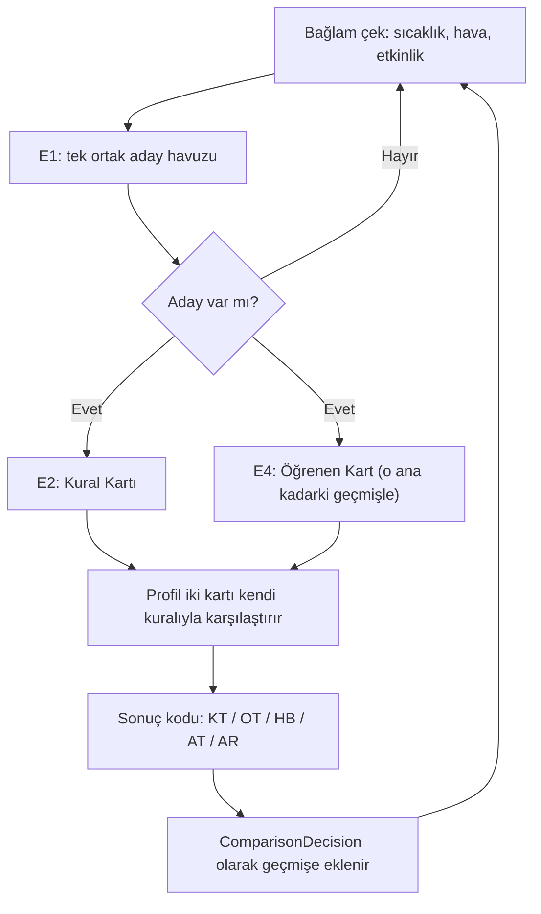
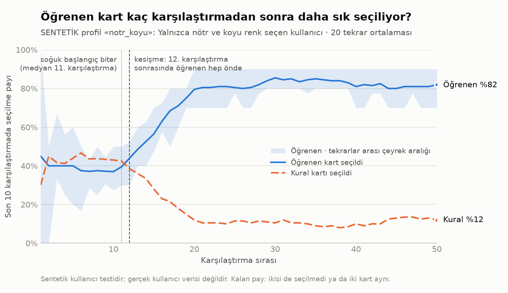

# E10 · Sentetik kullanıcı testi (ilk profil)

> **Bu belgedeki bütün sonuçlar SENTETİKTİR.** Karar veren bir insan değil, kodla
> yazılmış bir zevk kuralıdır. Sonuçlar gerçek kullanıcı tercihi, kullanıcı çalışması
> bulgusu veya iki yöntemden hangisinin gerçekte daha çok beğenildiğinin kanıtı değildir.
> Tezde ayrı "simülasyon" alt bölümünde, destekleyici kanıt olarak raporlanır.

## Durum ve kapsam

Aşama 1'in E10 maddesi tamamlandı: bir profil, ekransız test kodu, tek grafik ve T-37
testi. Dayanaklar birinci aşama planının E10 maddesi ("kaç karardan sonra öğrenen kartın
kural kartından daha sık seçildiği") ve genel planın T-37 testidir ("sentetik profilde
model 30 karar içinde tercihi yakalıyor ve grafik çıkıyor").

Kalan dört profil persona kartları kesinleşince eklenecek (hedef 29 Kasım). Persona
testi elle yapılmaya devam eder; bu kod onun yerine geçmez. Uç (FastAPI), C# veya
Supabase kullanılmaz.



Her karşılaştırmada E1 **bir kez** çalışır; iki kart aynı havuzdan seçilir. Bu, "iki
yöntem yalnız puanlamada ayrılır" kuralının simülasyondaki karşılığıdır ve testle
doğrulanır. Öğrenen kart, E4'ün gerçek `select_learned_outfit` işleviyle, soğuk
başlangıç, keşif ve kural kararı sınırı dahil olduğu gibi seçilir.

## Profil: `notr_koyu`

[synthetic_profiles.json](../recommendation/synthetic_profiles.json):

| Alan            | Değer                                                      |
| --------------- | ---------------------------------------------------------- |
| Açıklama        | Yalnızca nötr ve koyu renk seçen kullanıcı (planın örneği) |
| Sevilen renkler | siyah, beyaz, gri, bej, lacivert, kahverengi               |
| Sevilen tonlar  | koyu                                                       |
| Desen           | önemsenmez                                                 |
| Kabul eşiği     | 0.5                                                        |

**Uyum puanı:** kombinin ana parçalarından (dış giyim dahil, aksesuar hariç) hem sevilen
renkte hem sevilen tonda olanların payı. Örnek: siyah koyu tişört + lacivert koyu kot +
beyaz açık spor ayakkabı = 2/3.

**Karar kuralı (seçilen yorum):**

| Durum                              | Sonuç                                                  |
| ---------------------------------- | ------------------------------------------------------ |
| İki kartın ana parçaları aynı      | Uyum ≥ eşik ise AYNI_TEMIZ (AT), değilse AYNI_RED (AR) |
| İki kartın uyumu da eşiğin altında | HICBIRI (HB)                                           |
| Uyumu yüksek olan kart             | KURAL_TEMIZ (KT) ya da OGRENEN_TEMIZ (OT)              |
| Uyumlar eşit                       | Profil tohumuyla rastgele KT ya da OT                  |

Profil parça değiştirmez ve tepkisiz kalmaz; bu yüzden `_DEGISIKLIKLE`, `_SECILDI`,
BEKLIYOR ve TEPKISIZ üretilmez. AT/AR, E4 kuralına göre öğrenme örneği üretmez.

Renk listesi profilin zevkidir; E2'nin nötr grubuyla aynı renkler seçildi ama E2
ayarları okunmaz. Ton koşulu bilerek eklendi: E2 tonu hiç puanlamaz, E3 ise tonu
özellik olarak verir. Profil bu yüzden kural yönteminin göremediği ama öğrenen yöntemin
görebildiği bir tercihi temsil eder (bkz. Sınırlılıklar).

## Ayarlar ve nedenleri

[synthetic_settings.json](../recommendation/synthetic_settings.json) (başlangıç ayarı):

| Ayar             | Değer                                     | Neden                                                                           |
| ---------------- | ----------------------------------------- | ------------------------------------------------------------------------------- |
| `decision_count` | 50                                        | Kullanıcı çalışması 7 gün; 30 kararlık T-37 sınırının ötesini de göstermek için |
| `run_count`      | 20                                        | Tek tohumun şansını ortalamak; çeyrek aralığı çizilebilsin                      |
| `window`         | 10                                        | Soğuk başlangıç sınırıyla aynı ölçek; "son 10 karşılaştırmada seçilme payı"     |
| `base_seed`      | 42                                        | Demo/test tohumu; tekrar `i` için tohum 42 + i                                  |
| `temperatures`   | 0, 3, 6, 9, 12, 15                        | Kasım–Aralık hissedilen sıcaklıkları; kullanıcı çalışması Aralık'ta             |
| `conditions`     | fırtına dışındaki 6 hava kodu             | Eşit olasılık; ıslak gün yedeği de çalışsın                                     |
| `style_weights`  | günlük 0.6, iş 0.25, spor 0.1, davet 0.05 | Seçilen yorum: günlük kullanım ağırlıklı                                        |

Dolap: [sample_wardrobe.json](../tests/sample_wardrobe.json) (35 sentetik parça). Persona
dolapları kesinleşince profil başına dolap verilebilir (`--wardrobe`).

Her tekrar beş ayrı `random.Random` akışı kullanır (bağlam, E1, E2, E4, profil); tohum
metinleri `"{tohum}:{akış}"`. Böylece bir bileşenin tükettiği rastgele sayı diğerini
kaydırmaz ve sonuç aynı komutla birebir yeniden üretilir.

## Ölçüt: kesişme noktası

Her karşılaştırma sırası _k_ için, her tekrarda son 10 karşılaştırmada (ilk 9 sırada o
ana kadarki bütün karşılaştırmalarda) öğrenen kartın ve kural kartının seçilme payı
hesaplanır, sonra 20 tekrarın ortalaması alınır. **Kesişme noktası**, o sıradan
sonuna kadar öğrenen payının her sırada kural payından büyük kaldığı ilk _k_'dır
(seçilen yorum). Geçici öne geçişler sayılmaz.

T-37'deki "30 karar içinde tercihi yakalıyor" ifadesi bu ölçütle "kesişme ≤ 30" olarak
test edildi. Ek olarak son pencerede öğrenen payının kural payının iki katından büyük
olması istenir.

## Sonuç (sentetik)

```bash
python -m recommendation.synthetic --profile notr_koyu
```



| Ölçü                                    | Değer                              |
| --------------------------------------- | ---------------------------------- |
| Toplam karşılaştırma                    | 20 tekrar × 50 = 1000              |
| Sonuç kodları                           | OT 730, KT 175, AT 51, HB 42, AR 2 |
| Soğuk başlangıcın bittiği sıra (medyan) | 11                                 |
| Kesişme noktası                         | **12. karşılaştırma**              |
| 10. sıradaki pencere (soğuk başlangıç)  | öğrenen %37, kural %43             |
| 30. sıradaki pencere                    | öğrenen %86, kural %11             |
| 50. sıradaki pencere                    | öğrenen %82, kural %12             |

Sıra sıra değerler [E10-notr_koyu.csv](figures/E10-notr_koyu.csv) dosyasındadır
(öğrenen/kural payı, çeyrekler, "ikisi de seçilmedi", tek kart ve `model` modu payı).

Okuma: soğuk başlangıçta öğrenen kart rastgele olduğu için iki kart yakındır. Model
devreye girdikten (yaklaşık 11. karşılaştırma) hemen sonra öğrenen kart öne geçer ve
yaklaşık 20. karşılaştırmada %80 civarına oturur. Tavanın %100 olmamasının nedenleri:
%10 keşif seçimi, kural kartının da zaman zaman tamamen koyu nötr kombin bulması ve
eşit uyumda profilin rastgele seçmesi.

## Testler

[test_synthetic.py](../tests/test_synthetic.py), 23 test:

| Kontrol            | Sonuç                                                                                                  |
| ------------------ | ------------------------------------------------------------------------------------------------------ |
| Profil             | Uyum payı, aksesuarın etkisizliği, geçersiz kod/eşik/boş profil reddi                                  |
| Karar kuralı       | Yüksek uyum seçilir; ikisi eşik altı HB; aynı kart AT/AR; eşitlikte iki kart da çıkabiliyor ve tohumlu |
| Ayarlar            | Bilinmeyen hava/etkinlik kodu, sıfır ağırlık, eksik alan reddi                                         |
| Ortak havuz        | Her karşılaştırmada E1 bir kez; iki kart aynı `candidates` nesnesinden                                 |
| Soğuk başlangıç    | 10 öğrenme kararına kadar `soguk_baslangic`, sonra `model`/`kesif`                                     |
| Tekrarlanabilirlik | Aynı tohum aynı karar dizisi; farklı tekrar farklı dizi                                                |
| Eğri               | Pencere payları, tekrar ortalaması/çeyrekler, kesişme tanımı elle hesapla                              |
| **T-37**           | 10 tekrar × 40 karşılaştırmada kesişme ≤ 30; PNG ve CSV yazılıyor; komut çıktısı "SENTETİK" diyor      |

**Önceki 142 test + 23 E10 testi = 165 test geçti.**

```bash
python -m unittest discover -s tests -v
python -m unittest tests.test_synthetic -v
python -m recommendation.synthetic --profile notr_koyu
python -m recommendation.synthetic --runs 5 --decisions 30 --output-dir /tmp/e10
```

Grafik için `matplotlib==3.11.2` eklendi (`requirements.txt`). E1–E4 ve demo matplotlib
olmadan da çalışır; içe aktarma yalnız grafik çizilirken yapılır.

## Sınırlılıklar

- **Sentetik karar verici.** Profil kendi kuralını hiç şaşmadan uygular; gerçek
  kullanıcılar tutarsızdır, ruh hâline ve kıyafetin kendisine göre seçer.
- **Profil, kural yöntemine karşı bilerek ayırt edici.** E2 tonu puanlamadığı için bu
  profilin zevkini kural kartı ancak tesadüfen karşılar. Sonuç "öğrenen yöntem, E3
  özelliklerinde görünen tutarlı bir tercihi yaklaşık 10–20 kararda yakalayabiliyor"
  diye okunmalıdır; "öğrenen yöntem daha iyidir" diye değil. E2'nin kuralına zaten uyan
  bir profilde (ör. yalnız renk uyumuna bakan) iki kart arasında fark beklenmez; bu,
  kalan profillerle gösterilmelidir.
- **Tek test dolabı.** 35 parçalık dolapta koyu nötr seçenek sayısı sınırlıdır; daha
  büyük ya da farklı dolaplarda öğrenme hızı değişebilir.
- **Basit bağlam dağılımı.** Sıcaklık ve hava eşit olasılıkla, birbirinden bağımsız
  çekilir; gerçek hava ardışık günlerde ilişkilidir.
- **Değişiklik ve red yok.** Profil `_DEGISIKLIKLE` / `_RED` üretmediği için bu
  sonuçların öğrenme örneği yolu test edilmedi; E4 birim testleri bunları kapsar.
- Modelin sayısal çıktıları platform veya kütüphane sürümüyle çok küçük değişebilir;
  kesişme noktası birkaç sıra kayabilir.

## Sonraki işler

- Persona kartları kesinleşince kalan 4 profil `synthetic_profiles.json`'a eklenecek. Biçim renk, ton ve desen koşullarını destekler; gerekirse alt tür koşulu eklenir.
- Kalan profillerden en az biri E2 kuralıyla uyumlu seçilmeli ki iki yöntemin eşit
  kaldığı durum da raporlanabilsin.
- Beş profil hazır olunca grafikler aynı ölçekte yan yana çizilebilir.
