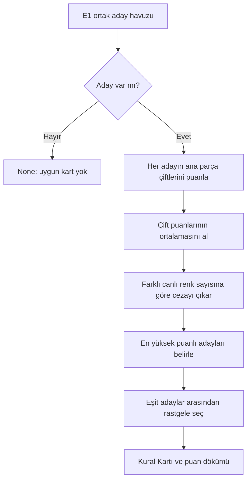

# E2 · Kural tabanlı kart seçimi raporu

## Durum ve kapsam

E2'nin yerel uygulaması, E1 ile birlikte çalışması ve davranış testleri tamamlandı.
E1'in ürettiği uygun adaylar sabit renk kurallarıyla puanlanır ve Kural Kartı seçilir.
E1 filtreleri yeniden çalıştırılmaz; adayların içeriği veya sırası değiştirilmez.

Bu aşama kullanıcı geçmişini kullanmaz ve model eğitmez. E3/E4 öğrenen yöntem,
E10 simülasyonu, FastAPI uçları ve C# JSON sözleşmesi ayrı işlerdir. Yerel testler
C# entegrasyonunun veya gerçek kullanıcı beğenisinin doğrulandığı anlamına gelmez.

## İşleyiş



İleride öğrenen yöntem de **aynı E1 havuzunu** kullanmalı. İki kart için E1'i ayrı
ayrı çalıştırmak, aday sınırı nedeniyle yöntemlerin farklı seçenekleri görmesine
yol açabilir. E2'nin renk ilişkileri, uyum puanları ve cezası öğrenen yöntemin
özellik vektörüne aktarılmamalı.

## Renk ilişkileri ve başlangıç ayarları

Kuralların kapsamı DolabımAI Geliştirme Planı'nın E2 görevi ve DolabımAI Proje
Planı'nın renk puanlaması açıklamalarına dayanır. Komşu renklerin çemberde yan yana
olması ve kırmızı–yeşil, turuncu–mavi, sarı–mor karşıtlıkları için
[Adobe renk çemberi açıklaması](https://www.adobe.com/uk/creativecloud/design/discover/color-wheel.html)
kavramsal referanstır. Aşağıdaki yedi renkli sıra, nötr grubu ve sayısal puanlar
proje için seçilmiş uygulama ayarlarıdır; evrensel bir renk uyumu ölçümü değildir.

| Ayar | Değer |
| --- | --- |
| Nötr renkler | `siyah`, `beyaz`, `gri`, `bej`, `lacivert`, `kahverengi` |
| Canlı renk çemberi | `kirmizi → turuncu → sari → yesil → mavi → mor → pembe → kirmizi` |
| Karşıt çiftler | `kirmizi–yesil`, `turuncu–mavi`, `sari–mor` |
| Yüksek / orta / düşük puan | 3 / 2 / 1 |
| Fazladan canlı renk cezası | İkiden sonraki her farklı canlı renk için 0,5 |

Çember, katalogdaki yedi nötr olmayan renk koduna uyarlanmış basit bir sıralamadır;
RGB/HSV açıları hesaplanmaz. Pembe, mor ve kırmızının komşusudur; tanımlı karşıt
çifti yoktur. Karşıtlık, yedi elemanlı listenin karşı indeksinden türetilmez,
ayar dosyasındaki üç çiftten okunur. Lacivert proje kuralı gereği nötrdür.

### İki parça nasıl puanlanır?

Kurallar aşağıdaki öncelikle uygulanır; her çift yalnız bir puan alır.

| Koşul | Puan | Örnek |
| --- | ---: | --- |
| En az bir renk nötr | 3 | Siyah–kırmızı |
| Aynı ana renk | 3 | Açık mavi–koyu mavi |
| Çemberde doğrudan komşu | 3 | Mavi–yeşil, pembe–kırmızı |
| Tanımlı karşıt çift | 2 | Mavi–turuncu |
| Diğer eşleşmeler | 1 | Kırmızı–mor |

Puan simetriktir: mavi–turuncu ile turuncu–mavi aynıdır. Aynı renk hem aynı tonda
hem farklı tonlarda yüksek puan alır. Ton farkı ve `is_patterned` için ayrıca ödül
veya ceza yoktur; veride korunurlar.

### Kombin puanı nasıl hesaplanır?

Dış giyim dahil bütün ana parçaların sırasız çiftleri kullanılır. İki parçada 1,
üç parçada 3, dört parçada 6 çift oluşur. Aksesuarlar hem çiftlerden hem canlı renk
sayımından çıkarılır. Toplam yerine ortalama kullanmak, sırf daha fazla parçası
olduğu için bir şablonun daha yüksek puan almasını önler.

```text
çift_ortalaması = çift puanlarının toplamı / çift sayısı
canlı_renk_sayısı = nötr olmayan farklı ana renklerin sayısı
ceza = 0,5 × max(0, canlı_renk_sayısı − 2)
toplam = max(0, çift_ortalaması − ceza)
```

İki kırmızı ve iki mavi parça, dört canlı parça fakat **iki farklı canlı renk**
demektir; renk sayısı cezası almaz. Parça sırası puanı değiştirmez.

| Ana parça renkleri | Çift ortalaması | Farklı canlı renk | Ceza | Toplam |
| --- | ---: | ---: | ---: | ---: |
| Siyah, beyaz | 3 | 0 | 0 | 3 |
| Mavi, turuncu | 2 | 2 | 0 | 2 |
| Mavi, turuncu, siyah | 8/3 | 2 | 0 | 8/3 ≈ 2,667 |
| Kırmızı, mavi, mor | 5/3 | 3 | 0,5 | 7/6 ≈ 1,167 |
| Kırmızı, sarı, mavi, pembe | 4/3 | 4 | 1 | 1/3 ≈ 0,333 |
| Mavi, turuncu, siyah + yeşil dış giyim | 2,5 | 3 | 0,5 | 2 |

Seçim yuvarlanmamış toplamla yapılır; demo yalnız gösterim için üç ondalık basamak
kullanır. Eşit en yüksek puanlı adaylar arasından eşit olasılıkla seçim yapılır.
Sabit tohum testleri tekrarlanabilir kılar; motor sabit tohum zorunlu tutmaz.

## Dosyalar ve kullanım

| Dosya | Sorumluluk |
| --- | --- |
| [rule_settings.json](../recommendation/rule_settings.json) | Renk grupları, çember, karşıt çiftler ve sayısal ayarlar |
| [rule_based.py](../recommendation/rule_based.py) | Ayar doğrulama, çift/kombin puanlama ve kart seçimi |
| [demo.py](../recommendation/demo.py) | `--method rule` ile E1 havuzundan kart üretimi |
| [test_rule_based.py](../tests/test_rule_based.py) | E2 davranışı, E1 bağlantısı ve demo testleri |

`score_pair` iki renk kodunun puanını; `score_outfit` bir kombinin puan dökümünü
verir. `select_rule_outfit` bir aday iterable'ı alır ve `RuleSelection` döndürür:

| Alan | Anlamı |
| --- | --- |
| `outfit` | Seçilen mevcut E1 adayı |
| `score.pair_average` | Ana parça çiftlerinin puan ortalaması |
| `score.vivid_color_count` | Farklı canlı renk sayısı |
| `score.penalty` | Canlı renk sayısı cezası |
| `score.total` | Seçimde kullanılan son puan |
| `tied_best_count` | En yüksek puanı paylaşan aday sayısı |

Boş havuzda sonuç `None` olur. Puanlamak için en az iki ana parça gerekir;
yinelenen ana parça kimlikleri ve bilinmeyen renkler hata verir. Şablon, sıcaklık,
etkinlik ve oturum içi ret denetimi E1'in sorumluluğundadır.

Ayarlar yüklenirken katalogdaki 13 rengin birer kez kapsanması, komşuluk ile
karşıtlığın çelişmemesi, puanların sıralı ve sonlu olması kontrol edilir.
Kurallar kullanıcıdan kullanıcıya veya karar geçmişine göre değişmez.

## Doğrulama sonuçları

Python 3.12 ile **30 E1 + 34 E2 = 64 test geçti**; hata veya başarısızlık yok.
E1 filtreleme kodu, katalog ve örnek dolap değiştirilmedi.

| Alan | Doğrulanan davranış |
| --- | --- |
| Renk çiftleri | Bütün nötr–renk eşleşmeleri ve 7 × 7 canlı renk tablosu |
| Ortalama ve ceza | İki/üç/dört parça, üç/dört farklı canlı renk, tekrar eden renkler, sıfır alt sınırı |
| Dış giyim ve aksesuar | Dış giyimin puana katılması, aksesuarın dışarıda kalması |
| Ton, desen, sıra | Ton/desen ek ağırlık taşımıyor; parça sırası puanı değiştirmiyor |
| Seçim | En yüksek puan, eşitlik, sabit tohum, boş havuz, yuvarlamasız karşılaştırma |
| E1 bağlantısı | Seçilen kart havuzda bulunuyor; havuz değişmiyor; reddedilen kombin seçilmiyor |
| Ayarlar | Dosyadan farklı puan yükleme, hatalı renk grubu/çift/puan/yapıyı reddetme |
| Demo | Varsayılan aday görünümü, kart ve puan dökümü, boş havuz mesajı |

### Örnek dolapla çalıştırılan senaryolar

Aşağıdaki sonuçlarda varsayılan ayarlar ve `--seed 42` kullanıldı.
Kimlikler seçilen karttaki ana parçaları gösterir; dış giyim dahildir.

| Hissedilen / hava / etkinlik | Aday | Kart kimlikleri | Puan | En yüksek puanda eşit aday |
| --- | ---: | --- | ---: | ---: |
| 24 °C / yağmurlu / günlük | 25 | 1, 16, 17 | 3 | 24 |
| 10 °C / yağmurlu / günlük | 100 | 1, 10, 17, 24 | 3 | 70 |
| 28 °C / güneşli / iş | 12 | 4, 15, 21 | 3 | 11 |
| 6 °C / karlı / günlük | 100 | 1, 10, 17, 24 | 3 | 70 |
| 50 °C / güneşli / günlük | 0 | Kart yok | — | — |

**Eşitliklerin yorumu:** Nötr renkler her renkle yüksek puan aldığı için bu örnek
dolapta çok sayıda aday 3 puana ulaşıyor. Varsayılan senaryoda 25 adayın 24'ü eşit.
Bu, tanımlı kuralların ve dolabın renk dağılımının sonucudur; kullanıcı beğenisi
veya yöntemin başarısı olarak yorumlanmamalı. Eşitliği azaltmak için bu aşamada
planda olmayan yeni kurallar eklenmedi. E10 karşılaştırmasında bu dağılım da izlenmeli.

### Yeniden çalıştırma

Komutlar depo kökünde, sanal ortam etkinleştirildikten sonra çalıştırılır.

```bash
# Bütün E1 ve E2 testleri
python -m unittest discover -s tests -v

# Yalnız E2 testleri
python -m unittest discover -s tests -p 'test_rule_based.py' -v

# Varsayılan E1 aday görünümü
python -m recommendation.demo

# E2 kartı ve puan dökümü
python -m recommendation.demo --method rule
python -m recommendation.demo --method rule --temperature 10 --weather yagmurlu --style gunluk
python -m recommendation.demo --method rule --temperature 28 --weather gunesli --style is
python -m recommendation.demo --method rule --temperature 6 --weather karli --style gunluk
python -m recommendation.demo --method rule --temperature 50 --weather gunesli --style gunluk
```

## Bekleyen karar ve entegrasyon işleri

- Yedi renkli komşuluk sırası, pembe yorumu ve 3/2/1 ile 0,5 değerleri belgelenmiş
  başlangıç tercihleridir. Değişiklik gerekirse ayar, beklenen test sonuçları ve
  bu rapor birlikte güncellenmeli; değerlendirme sırasında aynı ayarlar korunmalı.
- A3/D1 kapsamında seçilen `Outfit` ve boş havuz sonucu C# servis sözleşmesine eşlenmeli.
- [E1'deki dış giyim yorumu ve D5 teyidi](E1-notes.md#e1-için-bekleyen-teyit-ve-entegrasyon-işleri)
  ortak havuzu etkiler; E2 bu kararları değiştirmez.
- E3/E4 ve E10'da ortak aday havuzu, kartlardan gelen kararlar ve karşılaştırma
  ölçümleri bağlanmalı. E2 puanı kullanıcının seçim olasılığı değildir.
