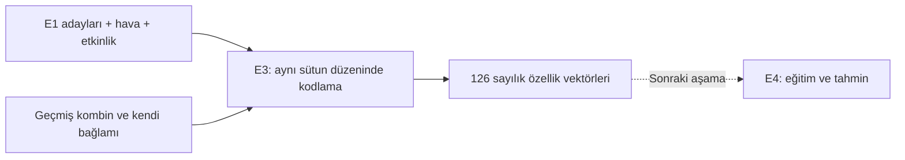

# E3 · Kombin özelliklerinin sayısal temsili

## Durum ve kapsam

E3'ün yerel uygulaması, terminal demosu ve davranış testleri tamamlandı.
Kaynak, birinci aşama planının E3 maddesidir: alt tür, ana renk, ton, desen,
canlı renk sayısı, etkinlik ve sıcaklık modele verilir; komşu/karşıt renk bilgisi
verilmez. Özellikler konuma göre ayrılmıştır: açık üst ve koyu alt ile koyu üst
ve açık alt farklı vektörler oluşturur.

E3 yalnızca sayısal temsil üretir. Lojistik regresyon, olumlu/olumsuz örnek çıkarma,
soğuk başlangıç ve keşif E4'ün kapsamındadır. FastAPI ve C# entegrasyonu ayrıdır.



## Özellik şeması

Sürüm `FEATURE_SCHEMA_VERSION = "e3_v1"`. Konum sırası sabittir:
`ust`, `alt`, `tek_parca`, `dis`, `ayakkabi`. Her konumda sırasıyla varlık,
alt tür, renk, ton ve desen alanları gelir. Alt tür, renk, ton ve etkinlik kodları
kendi gruplarında alfabetik sıralıdır. Kataloğun satır sırası sütun sırasını etkilemez.

| Alan | Temsil | Örnek sütun |
| --- | --- | --- |
| Konumda parça var mı? | Var 1, yok 0 | `ust.present` |
| Alt tür | O konumun alt türleri için one-hot | `ust.subtype=tisort` |
| Ana renk | 13 renk için one-hot | `ust.color=mavi` |
| Ton | 3 ton için one-hot | `ust.tone=acik` |
| Desen | Desenli 1, düz 0 | `ust.is_patterned` |
| Etkinlik | 4 tarz için one-hot | `context.style=gunluk` |
| Sıcaklık | Ham hissedilen sıcaklık, °C | `context.feels_like_temp` |
| Canlı renk sayısı | Farklı nötr olmayan ana renklerin sayısı | `outfit.vivid_color_count` |

One-hot grubunda seçilen kodun değeri 1, diğerleri 0'dır. Sayısal çıktıdaki bütün
değerler `float` türündedir. Eksik konumun bütün alanları 0 olur; `present` alanı,
parça yokluğu ile düz desenli parça arasındaki ayrımı korur.

### Neden 126 sütun?

| Bölüm | Alt tür sütunu | Diğer sütunlar | Toplam | Sıfır tabanlı indeksler |
| --- | ---: | ---: | ---: | --- |
| Üst | 8 | 1 varlık + 13 renk + 3 ton + 1 desen | 26 | 0–25 |
| Alt | 6 | 18 | 24 | 26–49 |
| Tek parça | 2 | 18 | 20 | 50–69 |
| Dış giyim | 7 | 18 | 25 | 70–94 |
| Ayakkabı | 7 | 18 | 25 | 95–119 |
| Etkinlik | — | 4 | 4 | 120–123 |
| Hissedilen sıcaklık | — | 1 | 1 | 124 |
| Farklı canlı renk sayısı | — | 1 | 1 | 125 |
| **Toplam** | **30** | **96** | **126** | |

Katalogdaki 35 alt türün 5'i aksesuardır; bu yüzden ana parçalarda 30 alt tür sütunu
vardır. `feature_names()` sütunların tam listesini verir. Sütunları eğitim örneklerinde
görülme sıklığı belirlemez; geçmişte hiç görülmemiş katalog renklerinin de sütunu vardır.

Katalog kodları, nötr sınıflandırması veya özellik anlamı değişirse şema sürümü,
testler ve bu rapor birlikte güncellenmeli. Aynı modelin eğitim ve tahmin verileri
aynı şemayı kullanmalı; eski vektörler yeni sütunlarla yorumlanmamalı.

### Canlı renk sayısı ve kurallardan bağımsızlık

Nötr grup: `siyah`, `beyaz`, `gri`, `bej`, `lacivert`, `kahverengi`.
Bu gruptaki renkler sayılmaz. İki kırmızı ve iki mavi parça, **2 farklı canlı renk**
demektir. Dış giyim sayılır; aksesuarlar sayılmaz.

Bu sayı planda açıkça istenen ham özelliktir. E3 onu kendi nötr tanımıyla hesaplar;
E2'nin ayar dosyasını veya puanlama modülünü okumaz. Üçüncü renge ceza uygulamaz,
renklerin komşu/karşıt olduğunu bildirmez. E2 ayarlarının değişmesi E3 vektörünü
değiştirmez.

Parça/kullanıcı kimliği, kartın yöntemi, seçim sonucu, E2 puanı, uyum cezası ve
renk çemberi sütunları yoktur. Hava koşulu kodu, kıyafetin sıcaklık aralığı ve hava
işaretleri de özellik değildir; sıcaklık olarak yalnız hissedilen değer kullanılır.

## Arayüz ve doğrulama

[features.py](../recommendation/features.py) mevcut `Outfit`, `ClothingItem` ve
`Weather` modelleriyle çalışır; yalnız Python standart kütüphanesini kullanır.

| Arayüz | Çıktı |
| --- | --- |
| `feature_names()` | `tuple[str, ...]`, sütun adları |
| `encode_outfit(outfit, weather, style)` | `tuple[float, ...]`, tek vektör |
| `encode_outfits(candidates, weather, style)` | `tuple[tuple[float, ...], ...]`, aday sırasındaki vektörler |

Toplu dönüşüm tek geçişli iterable kabul eder; adayların kimlikleri ve sırası
değişmez. Boş havuz `()` verir. E4, boş havuzu modele göndermeden ele almalı.

Bilinmeyen etkinlik, bilinmeyen şablon, zorunlu ana parça eksikliği, aynı konumda
iki ana parça, yinelenen ana parça kimliği ve şablona ait olmayan ana parça
`ValueError` üretir. `ust_alt` üst, alt ve ayakkabı; `tek_parca` tek parça ve
ayakkabı gerektirir. İkisine de en fazla bir dış giyim eklenebilir.

Renk/ton/alt tür geçerliliği mevcut `ClothingItem`, sonlu sıcaklık kontrolü mevcut
`Weather` modeli tarafından sağlanır. E3 sıcaklık, tarz, hava veya durum filtresi
uygulamaz. Böylece geçmişte gösterilen, sonradan silinen kıyafetlerin etiketleri
elde mevcutsa geçmiş kombin de kodlanabilir.

## Örnek dönüşüm ve demo

Varsayılan demoda ilk aday `elbise#29 + spor_ayakkabi#17` olur. Bağlam 24 °C,
yağmurlu ve günlüktür. Sıfırdan farklı özellikler:

```text
tek_parca.present: 1
tek_parca.subtype=elbise: 1
tek_parca.color=mavi: 1
tek_parca.tone=acik: 1
ayakkabi.present: 1
ayakkabi.subtype=spor_ayakkabi: 1
ayakkabi.color=beyaz: 1
ayakkabi.tone=acik: 1
context.style=gunluk: 1
context.feels_like_temp: 24
outfit.vivid_color_count: 1
```

Vektörde 126 değer bulunur; demo okunabilirlik için yalnız sıfırdan farklı olanları
yazar. Burada üst, alt ve dış giyim blokları sıfırdır. Gösterilen ilk aday bir
modelin seçtiği öneri değildir; E1 havuzundaki ilk adayı açıklamak içindir.

| Demo bağlamı | Aday / kodlanan vektör | Vektör uzunluğu | İlk aday kimlikleri |
| --- | ---: | ---: | --- |
| 24 °C, yağmurlu, günlük | 25 | 126 | 29, 17 |
| 10 °C, yağmurlu, günlük | 100 | 126 | 29, 17, 28 |
| 28 °C, güneşli, iş | 12 | 126 | 30, 21 |
| 50 °C, güneşli, günlük | 0 | Şema 126, vektör yok | — |

Sonuçlar örnek dolap, varsayılan filtre ayarları ve `--seed 42` ile elde edildi.
E3 rastgelelik içermez; tohum yalnız demodaki E1 aday sırasını belirler.

## Test sonuçları

**30 E1 + 34 E2 + 26 E3 = 90 test geçti.** Testler
[test_features.py](../tests/test_features.py) içinde tanımlıdır.

| Alan | Kontrol |
| --- | --- |
| Şema | 126 benzersiz sütun, sabit konum sınırları ve alfabetik kod sırası |
| Temsil | İki şablon, dış giyim, eksik blokların sıfır olması, tam beklenen örnek vektör |
| Değerler | Alt tür/renk/ton one-hot, desen, dört etkinlik, negatif/sıfır/ondalıklı sıcaklık |
| Canlı renk sayısı | Altı nötr renk, tekrar eden canlı renkler ve dış giyimin dahil olması |
| Değişmezlik | Parça sırası, kimlikler, aksesuarlar, durum ve uygunluk alanları |
| Konum ayrımı | Üst/alt renklerini değiştirince yalnız ilgili renk sütunlarının değişmesi |
| Doğrulama | Hatalı şablon, eksik/fazla konum, yinelenen konum ve ana parça kimliği |
| Entegrasyon | E1 havuzları, tekli/toplu eşleşme, sıra korunması ve boş havuz |
| Bağımsızlık | E2 ayarları/puanlarına erişmeden çalışma, ayrı süreçte E2'yi içe aktarmama |
| Demo | Şema, boyut ve özelliklerin gösterilmesi; aday yok mesajı |

Depo kökünde, sanal ortam etkinleştirildikten sonra:

```bash
python -m unittest discover -s tests -v
python -m unittest discover -s tests -p 'test_features.py' -v
python -m recommendation.demo --method features
python -m recommendation.demo --method features --temperature 10 --weather yagmurlu --style gunluk
python -m recommendation.demo --method features --temperature 28 --weather gunesli --style is
python -m recommendation.demo --method features --temperature 50 --weather gunesli
```

## E4'e bağlantı ve kalan işler

- Geçmiş kombin kendi karar anındaki etiketleri, etkinliği ve sıcaklığıyla kodlanmalı;
  bugünkü dolap özellikleri veya yeni isteğin bağlamı geçmişin yerine kullanılmamalı.
  Bu verilerin C#'tan gelişi A3 sözleşmesinde netleşmeli.
- Olumlu/olumsuz `y` etiketleri E4'te ayrı oluşturulacak; özellik vektörüne eklenmeyecek.
  Eğitim örnekleri ve yeni adaylar aynı E3 fonksiyonlarını kullanacak.
- Sıcaklık ve renk sayısı hamdır. Gerekli ölçekleme E4'te yalnız eğitim verisine
  uydurulup aynı dönüşüm adaylara uygulanmalı.
- Bu sürüm konuma göre ham özellikler içerir; renk çiftleri veya özellikler arası
  etkileşim sütunları yoktur. Bu temsil tek başına modelin renk ilişkilerini
  öğrendiğinin kanıtı değildir; öğrenme davranışı E4/E10'da değerlendirilecek.
- E1/E2 davranışları korunmuştur. E3 tamamlanması C# entegrasyonunun, model eğitiminin
  veya gerçek kullanıcı başarısının tamamlandığı anlamına gelmez.
