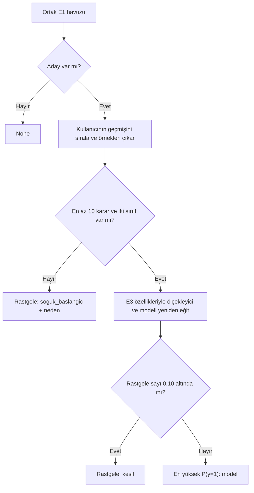

# E4 · Kararlardan öğrenen öneri yöntemi

## Durum ve kapsam

E4'ün yerel uygulaması, sentetik geçmişi, terminal demosu ve davranış testleri
tamamlandı. Dayanaklar birinci aşama planının E4 karar tablosu ve ortak kod listesinin
karşılaştırma kodlarıdır. E1 havuzu ve E3 `e3_v1` özellikleri kullanılır.

Her kullanıcı yalnız kendi geçmişinden öğrenir. Model, yeterli veri bulunan her
çağrıda yeniden eğitilir; model dosyası veya kullanıcılar arasında model önbelleği
yoktur. E2 renk ilişkileri ve puanları kullanılmaz.

Bu kayıt C# entegrasyonu veya gerçek kullanıcı başarısı onayı değildir. FastAPI,
Supabase, parça değiştirme ve E10 öğrenme eğrisi ayrı işlerdir.



## Geçmişin yerel sözleşmesi

[history.py](../recommendation/history.py) içindeki `ComparisonDecision`, kesinleşmiş
A3/C# JSON sözleşmesinin yerine geçmeyen bir iç modeldir.

| Alan | İçerik |
| --- | --- |
| `user_id`, `comparison_id` | Boş olmayan metin kimlikleri; özellik vektörüne girmez |
| `result_key` | Ortak listedeki iki harfli sonuç kodu |
| `completed_at` | Son karar için saat dilimi içeren zaman; JSON'da ISO 8601 |
| `weather` | Karar anındaki `feels_like_temp`, `condition` |
| `style` | Karar anındaki etkinlik |
| `rule_outfit`, `learned_outfit` | İlk gösterilen kombinlerin `template` ve tam `items` etiketleri |
| `final_outfit` | Varsa son kombin; değişiklikle kabulde zorunlu |

JSON kökü bir listedir; `load_history` kayıtları iç modellere dönüştürür. Öğrenmeye
giren kararlarda iki ilk kombin de zorunludur. Öğrenilmeyen durumlarda kombinler
boş olabilir. Son karar olmayan kayıtlarda tamamlanma zamanı `null` olabilir.

Geçmiş, bugünkü dolaptaki parça id'leriyle yeniden kurulmaz. E3, verilen eski
etiketleri eski bağlamla kodlar; silinmiş kıyafeti veya eski sıcaklığı E1 filtresinden
tekrar geçirmez. Kayıtlar tamamlanma zamanı, eşitlikte karşılaştırma kimliğiyle
sıralanır. Farklı kullanıcı, tekrarlı kimlik, bilinmeyen kod, gerekli veri eksikliği
ve saat dilimi olmayan son karar zamanı açık hata verir.

## Karar tablosu

| Sonuç | Anahtar | Pozitif (1) | Negatif (0) |
| --- | --- | --- | --- |
| KURAL_TEMIZ / OGRENEN_TEMIZ | KT / OT | Seçilen ilk kombin | Seçilmeyen ilk kombin |
| KURAL_DEGISIKLIKLE / OGRENEN_DEGISIKLIKLE | KD / OD | Son kombin | Seçilenin ilk hâli ve seçilmeyen |
| KURAL_RED / OGRENEN_RED | KR / OR | Yok | İki ilk kombin; ana parçalar değişmişse son kombin |
| HICBIRI | HB | Yok | İki ilk kombin |
| BEKLIYOR / KURAL_SECILDI / OGRENEN_SECILDI | BK / KS / OS | Yok | Yok |
| AYNI_TEMIZ / AYNI_DEGISIKLIKLE / AYNI_RED / TEPKISIZ | AT / AD / AR / TP | Yok | Yok |

Aksesuarlar örneklerin özelliklerine ve ana kombin kimliğine dahil değildir.
Aynı karşılaştırmada aynı ana parça id kümesi ve etiket yalnız bir kez alınır.
Farklı karşılaştırmaların tekrarları korunur. Son kombin ilk hâline geri döndüyse
tablonun ürettiği farklı etiketler korunur; biri diğerine dönüştürülmez.

`TrainingExample` kaynak karşılaştırmayı, kaynak yöntemi, kombini, 126 özelliği ve
etiketi taşır. `TrainingData` örnekleri ve iki sayacı içerir; pozitif/negatif sayıları
örneklerden hesaplanır. Kaynak yöntem yalnız sınır uygulaması içindir, modele girmez.

## İki ayrı sayaç

| Sayaç | Artıran kararlar | Varsayılan eşik |
| --- | --- | ---: |
| `decision_count` | KT, KD, KR, OT, OD, OR, HB | 10 |
| `rule_decision_count` | Yalnız KT, KD, KR | 10 |

Bir karar iki veya üç örnek üretse de karar sayacı bir artar. Dokuz tamamlanmış
kararla öneri hâlâ soğuk başlangıçtır. On tamamlanmış karar varsa iki sınıf kontrolü
geçildiğinde eğitim yapılır; yani sonraki öneri model/keşif olabilir.

Kural sayacı için **10. kural kararının örnekleri dahildir**. Sayaç artırılmadan önce
o karar işlenir. İlk dönemin örnekleri sonraki çağrılarda silinmez; geçmiş baştan
kronolojik işlenerek aynı örnekler yeniden oluşturulur.

Kural sınırı dolduktan sonraki kararlar:

| Sonuç | Alınan yeni örnekler |
| --- | --- |
| KT, KD, KR | Yalnız ilk öğrenen kombin: 0 |
| OT | İlk öğrenen kombin: 1 |
| OD | Son öğrenen kombin: 1; ilk öğrenen kombin: 0 |
| OR | İlk öğrenen kombin: 0; değişmiş son öğrenen kombin varsa: 0 |
| HB | Yalnız ilk öğrenen kombin: 0 |

**Seçilen yorum:** Belgedeki kural kombininin artık kullanılmaması, öğrenen kartın
seçildiği kararlar dahil bütün sonraki kararlara uygulanır. Kural kartı seçildiyse
son hâli de kural kaynaklıdır. Bu yorum planlama sırasında kararlaştırılmıştır;
gelecekte farklılaşırsa testler, ayarlar ve rapor birlikte güncellenmelidir.

Örnek: 11 KT kararı, 11 geçerli karar ve 11 kural kararı demektir. İlk 10'undan
10 pozitif kural örneği, hepsinden 11 negatif öğrenen örneği alınır: toplam 21 örnek.

## Model, seçim ve hata davranışı

[learned.py](../recommendation/learned.py) şu arayüzü sağlar:

```python
select_learned_outfit(
    candidates, weather, style, history,
    user_id="demo", settings=None, rng=None,
)
```

Boş havuzda model eğitilmeden `None` döner. Dolu havuzda adaylar E3 ile doğrulanır;
rastgele seçim dalları hatalı adayı sessizce kabul etmez. E1 tekrar çalıştırılmaz.

| Durum | `ogrenen_mode` | `reason` |
| --- | --- | --- |
| Karar sayısı eşikten az | `soguk_baslangic` | `yetersiz_karar` |
| Eşik sağlanmış ama örnek yok | `soguk_baslangic` | `ornek_yok` |
| Etiketler yalnız 0 veya yalnız 1 | `soguk_baslangic` | `tek_sinif` |
| Eğitim yapılmış, rastgele sayı keşif oranından küçük | `kesif` | `None` |
| Eğitim yapılmış, diğer durum | `model` | `None` |

Tek sınıf durumunu soğuk başlangıç olarak kaydetmek, zorunlu rastgele seçimleri
%10 keşiften ayırmak için seçilen yorumdur. Karar adları aynı olsa da etiketler
iki sınıf olabilir: örneğin 10 temiz kabul, seçilenler için 1 ve seçilmeyenler için
0 üreterek eğitime yeterli olabilir.

Sonuç `LearnedSelection` içinde `outfit`, `ogrenen_mode`, `probability`, `reason`,
`decision_count`, `rule_decision_count`, `positive_count`, `negative_count` bulunur.
Rastgele seçimde `probability=None`; model seçiminde seçilen adayın `P(y=1)` değeridir.
Bu değer gerçek kullanıcıda ölçülmüş kabul olasılığı veya doğruluk oranı değildir.

### Eğitim hattı

Python 3.12 üzerinde `scikit-learn==1.9.1` kullanılır. `ColumnTransformer`, sütunları
E3 adlarından bulur; yalnız sıcaklık ve canlı renk sayısını `StandardScaler` ile
ölçekler, diğer 124 sütunu değiştirmeden geçirir. Ölçekleyici yalnız geçmiş örneklerde
öğrenir; yeni adaylar yalnız dönüşümden geçer. Böylece aday verisi eğitim ölçeğine
karışmaz. [scikit-learn veri sızıntısı rehberi](https://scikit-learn.org/stable/common_pitfalls.html)

`LogisticRegression`: `lbfgs`, L2 (`l1_ratio=0`), `C=1.0`, `tol=1e-4`,
`max_iter=1000`, `class_weight=None`, `warm_start=False`.
Bu sürümde eski `penalty` parametresi kullanılmaz.
[LogisticRegression belgeleri](https://scikit-learn.org/stable/modules/generated/sklearn.linear_model.LogisticRegression.html)

Her uygun çağrıda yeni ölçekleyici ve model oluşturulup eğitilir; keşif yapılacaksa
bile eğitim önce tamamlanır. Ardından %10 olasılıkla eşit olasılıklı rastgele seçim
yapılır. Model dalında `classes_` içindeki 1 sınıfının sütunu bulunur; en yüksek
yuvarlanmamış olasılık seçilir. Tam eşitlikte rastgele seçim yapılır.

Yakınsama uyarısı `RuntimeError` olur; eğitim hataları veya geçersiz olasılıklar
soğuk başlangıç/keşif sonucu olarak gizlenmez. Model çıktısı diske yazılmaz.

[learned_settings.json](../recommendation/learned_settings.json) eşikleri, keşif
oranını ve model parametrelerini içerir. Sınırlar negatif olmayan tam sayı, keşif
oranı [0, 1], C ve tolerans pozitif sonlu sayılar olmalıdır. Bu sürümün algoritması
lbfgs/L2 olarak doğrulanır; sıcak başlatma ve sınıf ağırlıkları kullanılmaz.

## Demo ve doğrulama

[sample_history.json](../tests/sample_history.json), `demo` kullanıcısının 12 sentetik
kararını tam kıyafet etiketleriyle içerir. Altı KT, altı OT kararı vardır; her seferinde
beyaz/açık tişörtlü kombin seçilir. Sonuç 12 pozitif ve 12 negatif örnektir. Kimlikler
ve zaman damgaları sentetiktir; gerçek kullanıcı veya Supabase verisi değildir.

```bash
python -m pip install -r requirements.txt
python -m unittest discover -s tests -v
python -m unittest discover -s tests -p 'test_history.py' -v
python -m unittest discover -s tests -p 'test_learned.py' -v

# Geçmiş yok: soğuk başlangıç
python -m recommendation.demo --method learned

# 12 sentetik karar: model
python -m recommendation.demo --method learned --history tests/sample_history.json --user-id demo

# Aynı geçmiş: keşif
python -m recommendation.demo --method learned --history tests/sample_history.json --user-id demo --seed 31

# Aday yok
python -m recommendation.demo --method learned --temperature 50 --weather gunesli
```

E1 ve E4 ayrı `random.Random(seed)` nesneleri kullanır. Tohumun keşif kararına
etkisi E1'in kaç rastgele sayı tükettiğine bağlı değildir. Modelin sayısal çıktıları
platform/kütüphane farklarıyla çok küçük değişebilir.

**90 mevcut test + 21 geçmiş testi + 31 öğrenen testi = 142 test geçti.**

| Kontrol | Sonuç |
| --- | --- |
| Bütün 14 sonuç kodu | Örnek tablosu veya yok sayma davranışı doğrulandı |
| Sayaçlar | 0/9/10/11 sınırları, bağımsız sayım ve eski örneklerin korunması geçti |
| Kural sınırı | Sınır sonrasındaki yedi öğrenilebilir sonucun tamamı kontrol edildi |
| Geçmiş | Sıralama, kullanıcı ayrımı, tekrarlı id, eksik veri, eski bağlam ve etiketler geçti |
| Sınıflar | Yalnız 0, yalnız 1, aynı sonuç türünden iki sınıf, boş örnek durumları geçti |
| Keşif | 0.10 sınırı ve yapılandırılabilir 0/1 uçları geçti |
| Çoklu rastgele deneme | Modeli taklit eden 1000 seçimde keşif sayısı 70–130 aralığında; bu gerçek kullanıcı ölçümü değil |
| Gerçek model | Yeni parça kimlikleriyle basit tercihi sıraladı; karşıt zevkli kullanıcılar birbirini etkilemedi |
| Ölçekleme | Eğitim ortalaması ve örnek sayısı doğrulandı; adaylar ölçeği değiştirmedi |
| Hata/izolasyon | Yakınsama ve eğitim hataları gizlenmedi; model dosyası oluşmadı |
| E1/E2/E3 | Önceki 90 test geçti; aday havuzu ve özellik şeması korundu |

## Sonraki işler

A3 entegrasyonunda sonuç kodları ve geçmiş etiket/bağlam kopyaları C# verisine
eşlenmeli. Sayaçların doğru kalması için geçmiş, başlangıçtan itibaren gerekli
kararları içermeli; yalnız son birkaç kararın gönderilmesi yeterli değildir.

E10'da ayrı sentetik simülasyon ve öğrenme eğrisi hazırlanacak. Bu testler modelin
gerçek kullanıcıda başarılı olduğunu veya her zevki öğreneceğini göstermez. E3'ün
konumsal ham özellikleri korunmuştur; renk çiftleri/etkileşimleri eklenmemiştir.
