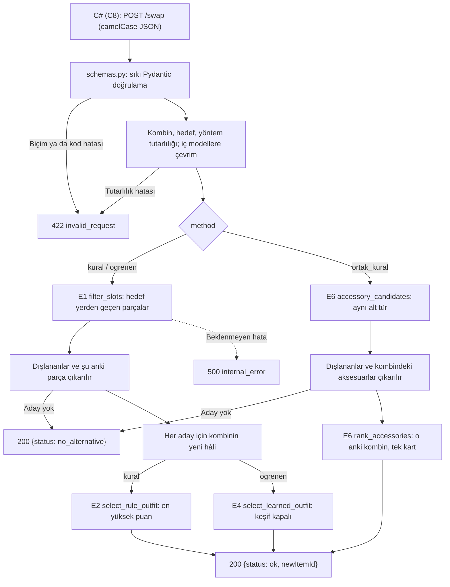

# E5 · `/swap` ucu raporu

## Durum ve kapsam

E5'in Python tarafı tamamlandı: `POST /swap` A3 sözleşmesinin 7. bölümündeki istek ve cevap
biçimiyle çalışıyor. Sözleşme örnekleriyle test edildi ve gerçek servis üzerinde `curl` ile
denendi. Uç, seçilen kombinde tek bir ana parçayı ya da tek bir aksesuarı değiştirir ve tek
bir yeni parça önerir. Uygun parça kalmadıysa `no_alternative` döner.

Genel plandaki ölçüt ("aynı kartta üç değiştirmede üç farklı parça, sonra uygun parça yok")
ve T-26'nın Python kısmı (aynı kartta aynı parça iki kez gelmiyor) üç yöntem için de testte
karşılanıyor. T-26'nın "düğme pasif" kısmı C# (C8, 1 Aralık) ve ekrana (B9 değiştirme kısmı,
2 Aralık) bağlıdır. Aksesuar **kaldırma** Python'a hiç gelmez; onu C# yapar.

Uç, api deposundaki A3 sözleşmesine göre yazıldı (beş onayla sabit, api PR #8, #9). Örnek
dosyalar `tests/contracts/` altına kopyalandı ve kaynaklarıyla birebir aynı.

## İşleyiş



| Dosya                                                     | Görev                                                                                                                 |
| --------------------------------------------------------- | --------------------------------------------------------------------------------------------------------------------- |
| [recommendation/swap.py](../recommendation/swap.py)       | FastAPI'den bağımsız değiştirme akışı                                                                                 |
| [recommendation/router.py](../recommendation/router.py)   | `/swap` ucu; hata biçimi ve süre logu `/recommend` ile aynı                                                           |
| [recommendation/schemas.py](../recommendation/schemas.py) | `SwapRequest`, `CurrentOutfitIn`; `/recommend` ile ortak dolap, bağlam ve geçmiş doğrulaması                          |
| [recommendation/filter.py](../recommendation/filter.py)   | E1'in yer filtresi `filter_slots` olarak ayrıldı; E1 ve E5 aynı filtreyi kullanıyor                                   |
| [tests/contracts/](../tests/contracts/)                   | `swap-request.json`, `swap-response.json`, `swap-response-no-alternative.json` (api `contracts/examples/`, `049ce75`) |
| [tests/test_swap.py](../tests/test_swap.py)               | Sözleşme, ölçüt, yöntem, filtre ve hata testleri                                                                      |

E1 ile E7'deki değişiklikler yalnız ayırmadır (refactor). `generate_candidates` ve
`RecommendRequest` davranışı değişmedi; E1 ve E7 testleri değiştirilmeden geçiyor.

## Yöntemler

| Yöntem        | Ne zaman                                | Adaylar                                                                             | Seçim                                                                                                                                                                 |
| ------------- | --------------------------------------- | ----------------------------------------------------------------------------------- | --------------------------------------------------------------------------------------------------------------------------------------------------------------------- |
| `kural`       | Kural kartı seçildiyse ya da tek kartta | E1 ortak ön filtresinden hedef yere geçen ana parçalar                              | Her aday kombinin kalan parçalarıyla birlikte E2 ile puanlanır (dış giyim dahil bütün çiftler, canlı renk cezası); en yüksek puanlı seçilir, eşitlikte `rng`          |
| `ogrenen`     | Öğrenen kart seçildiyse                 | Aynı                                                                                | E4 modeli `history` ile bu çağrıda eğitilir; en yüksek olasılıklı kombinin hedef parçası. Soğuk başlangıçta (10 karardan az, örnek yok ya da tek sınıf) rastgele aday |
| `ortak_kural` | Aksesuar değiştirmede                   | E6 aday adımlarından geçen, hedef aksesuarla **aynı alt türden** onaylı aksesuarlar | E6 `rank_accessories` kombinin **o anki** hâliyle tek kart olarak sıralar; ilk sıradaki önerilir                                                                      |

E2'nin "kalan parçalarla en uyumlu" ölçütü için kombinin bütün puanı kullanılır. Kalan
parçaların kendi aralarındaki çiftler her adayda aynı olduğundan sıralamayı yalnız yeni
parçanın çiftleri ve canlı renk sayısı belirler.

## Sözleşmeyle eşleme

| Sözleşme                            | İç kod                                                                                  |
| ----------------------------------- | --------------------------------------------------------------------------------------- |
| `method`                            | `kural`, `ogrenen`, `ortak_kural`; başka değer `422`                                    |
| `context`                           | `/recommend` ile aynı: `Weather`, E1 `style`, E6 `is_daytime`, `wants_accessories`      |
| `currentOutfit.itemIds`, `template` | Wardrobe'dan parçalarla `Outfit`; şablona uymalı                                        |
| `currentOutfit.accessoryIds`        | Wardrobe'daki aksesuarlar                                                               |
| `targetCategory`                    | `kural` ve `ogrenen` için zorunlu; kombindeki ana parçalardan birinin kategorisi        |
| `targetAccessoryId`                 | `ortak_kural` için zorunlu; `currentOutfit.accessoryIds` içinde olmalı                  |
| `excludedItemIds`                   | Aday olmaz; şu anki parça listede olmasa da aday olmaz                                  |
| `history`                           | Yalnız `ogrenen`'de dolu; kurallar `/recommend` ile aynı (`KT, KD, KR, OT, OD, OR, HB`) |
| Cevap                               | `{"status": "ok", "newItemId": <id>}` ya da `{"status": "no_alternative"}`              |

## Belirsizlikte seçilen yorumlar

Aşağıdakiler sözleşmede ve planda açıkça yazmayan noktalar için **seçilen yorumlardır**.

| Konu                                       | Seçilen yorum                                                                                              | Gerekçe                                                                                                                                                                               |
| ------------------------------------------ | ---------------------------------------------------------------------------------------------------------- | ------------------------------------------------------------------------------------------------------------------------------------------------------------------------------------- |
| Öğrenen değiştirmede keşif                 | **Yok.** Model eğitilebiliyorsa hep en yüksek olasılıklı parça seçilir                                     | Plan "o yer için en iyi parça" diyor. `/swap` cevabı seçilme biçimini taşımıyor ve değiştirme `learned_pick_modes` tablosuna yazılmıyor; %10 rastgele seçim analizde ayırt edilemezdi |
| Dışlama ve yedek kural                     | Dışlanan parçalar ve şu anki parça ortak ön filtreden **sonra** çıkarılır; ıslak/sıcak yedeğini tetiklemez | E1'deki tekrar engeli de en sonda uygulanır ve hiç gevşemez. Örnek: 24 °C ıslak günde yağmura uygun tek ayakkabı dışlanınca sandalet önerilmez, `no_alternative` döner                |
| Tekrar engeli                              | Uygulanmaz                                                                                                 | Sözleşme ön filtreyi "sıcaklık, etkinlik, ıslak ve sıcak hava" olarak sayıyor; `kural` ve `ortak_kural`'da `history` boş geldiği için uygulanamazdı da                                |
| Aksesuar değiştirmede alt tür              | Yalnız hedef aksesuarla aynı alt tür                                                                       | E6'da her alt türden en fazla bir aksesuar seçiliyor; atkının yerine bere gelirse kombindeki alt tür dengesi bozulurdu (E6 notundaki E5 bağlantısı da böyle yazılmıştı)               |
| Şu anki kombinin parçaları                 | Ön filtreden geçmesi aranmaz; yalnız wardrobe'da ve şablona uygun olmalı                                   | Kombin kullanıcının önündeki hâldir; filtre yalnız yeni parçaya uygulanır                                                                                                             |
| `history` kural/ortak kuralda dolu gelirse | `422`                                                                                                      | Sözleşme "diğer yöntemlerde boş liste" diyor; C8 yazılırken eşleme hatası logda görünsün                                                                                              |
| Hedef alanı eksik                          | `null` sayılır                                                                                             | `/recommend`'deki `finalOutfit` ile aynı; C#'ın `null` alanları atlaması zararsız                                                                                                     |
| `excludedItemIds`                          | Pozitif olmalı; tekrar ve dolapta olmayan id zararsız                                                      | Silinmiş bir parçanın id'si listede kalabilir; bunun yüzünden kullanıcıya `502` dönmesin                                                                                              |

## Doğrulama sonuçları

Python 3.12 ile bütün paket: **304 test geçti, 1 atlandı** (arka plan modeli testi). Bunların
**26'sı E5** testidir.

| Alan                                   | Doğrulanan davranış                                                                                                                                                                                                                                                    |
| -------------------------------------- | ---------------------------------------------------------------------------------------------------------------------------------------------------------------------------------------------------------------------------------------------------------------------- |
| E5 ölçütü, T-26 (Python)               | Sözleşme örneğinde üst giyim üç kez değiştiriliyor: üç farklı parça (2, 6, 7), dördüncüde `no_alternative`. Aynısı `ogrenen` (12 kararlık örnek geçmiş) ve `ortak_kural` (üç ek atkı) için de geçiyor                                                                  |
| Sözleşme biçimi                        | Örnek isteğin cevabı `swap-response.json` ile aynı anahtarlarda; `no_alternative` cevabı örnekle birebir; `500` hata biçimi                                                                                                                                            |
| `kural`                                | 18 °C'de mavi kotla gri sweatshirt (nötr) pembe bluzun (düşük puan) önüne geçiyor, 20 tohumda aynı                                                                                                                                                                     |
| Dışlama                                | Şu anki parça ve `excludedItemIds` hiç dönmüyor                                                                                                                                                                                                                        |
| Ortak ön filtre                        | Gömlek (iş/davet) ve atlet (22 °C üstü) örnek bağlamda hiç gelmiyor; yağmura uygun ayakkabı yoksa E1 gibi yedek açılıyor; dışlama yedeği açmıyor                                                                                                                       |
| `ogrenen`                              | Eğitilebilen modelde 40 tohumda tek sonuç (keşif yok); soğuk başlangıçta filtreden geçen aday                                                                                                                                                                          |
| `ortak_kural`, T-28 (değiştirme kısmı) | Aynı alt türden en uyumlu atkı seçiliyor, bere aday değil; üst daha önce sarı tişörtle değiştirildiyse sıralama yeni hâle göre değişiyor; aksesuar grubu dışındaki sıcaklıkta `no_alternative`                                                                         |
| `invalid_request`                      | Yöntem–hedef uyuşmazlığı, kombinde olmayan hedef, bilinmeyen kategori, wardrobe'da olmayan parça, şablona uymayan kombin (iki üst, aksesuar ana parçada, mont aksesuarda), kural yönteminde dolu geçmiş, bilinmeyen yöntem, fazla alan, metin id, sıfır id, bozuk JSON |

Testlerin davranışı yakaladığını görmek için kod dört yerden bilerek bozuldu (öğrenende
%10 keşif açık, kuralda rastgele seçim, şu anki parça dışlanmıyor, aksesuar sıralaması
o anki kombine bakmıyor); dördü de en az bir testi kırdı.

### Gerçek servisle deneme

```bash
python -m uvicorn service.main:app --port 8765
curl -X POST http://127.0.0.1:8765/swap -H 'Content-Type: application/json' \
  --data-binary @tests/contracts/swap-request.json
```

| İstek                                          | Cevap                                        |
| ---------------------------------------------- | -------------------------------------------- |
| Sözleşme örneği                                | `200 {"status": "ok", "newItemId": 2}`       |
| Aynı istek, `excludedItemIds: [1, 2, 5, 6, 7]` | `200 {"status": "no_alternative"}`           |
| `{"bozuk": 1}`                                 | `422 invalid_request`, eksik alanlar mesajda |

Örnekte siyah tişört (2) ile gri sweatshirt (6) eşit puanlıdır; hangisinin geleceği
rastgeleliğe bağlıdır. Sözleşme örneğindeki `newItemId: 6` de geçerli bir cevaptır.

### Yeniden çalıştırma

```bash
python -m unittest discover -s tests -v
python -m unittest tests.test_swap -v
```

## Sınırlılıklar

- Değiştirme seçilen kombinin parçasını tek tek değiştirir; yeni parçanın şablonu
  değiştirmesi (ör. üst + alt yerine tek parça) kapsam dışıdır. Sözleşme de bunu tanımlamıyor.
- `ogrenen` her istekte modeli yeniden eğitir; uzun geçmişte süre 30 saniyelik C# sınırına
  karşı pilotta ölçülmeli (`/recommend` ile aynı sınırlılık).
- C8 henüz yok; C# ↔ Python denemesi 4. haftada (1 Aralık) yapılabilir.
- `tests/contracts/` bir kopyadır; api deposundaki değişiklik otomatik gelmez.

## Sonraki işler

- C8: C# istemcisiyle uçtan uca deneme; `excludedItemIds` alanının
  `outfit_changes.old_item_id` ile doldurulduğunun kontrolü.
- B9 değiştirme kısmı: `no_alternative`'de düğmenin pasif olması (T-26).
