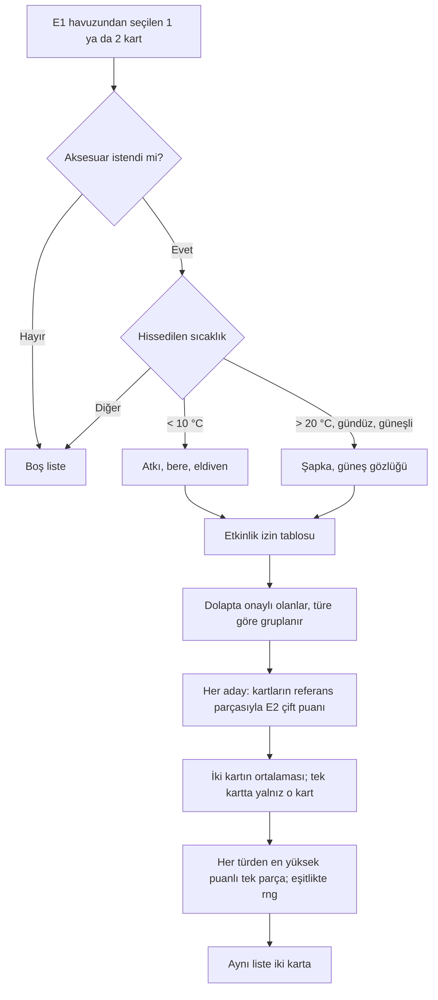

# E6 · Ortak aksesuar kuralı raporu

## Durum ve kapsam

E6'nın yerel uygulaması, ayar dosyası ve davranış testleri tamamlandı. Kural iki
yöntemin dışında, ortak ve sabittir: Kural Kartı ve Öğrenen Kart için birebir aynı
aksesuar listesi üretir ve kullanıcı tepkilerinden öğrenmez (FR-19).

Bu iş `/recommend` ucunu (E7), aksesuar değiştirmeyi (E5) ve C# JSON sözleşmesini
kapsamaz. E7 iki kart seçildikten sonra `select_accessories`'i bir kez çağıracak ve
`accessoryIds` alanını bu listeden dolduracak. E5'in `ortak_kural` değiştirmesi aynı
aday ve sıralama fonksiyonlarını kullanacak şekilde ayrı tutuldu.

## İşleyiş



Adımların sırası Proje Planı'ndaki çalışma sırasıyla aynıdır: istenmediyse hiçbir şey →
sıcaklığa göre adaylar → akşam/gece şapka ve güneş gözlüğü çıkar → etkinliğin izin
vermediği çıkar → gardıropta olmayan çıkar → aynı türden birden fazlaysa renk uyumu.

## Kaynaklar

| Kaynak                                           | Kullanılan kısım                                                                                               |
| ------------------------------------------------ | -------------------------------------------------------------------------------------------------------------- |
| DolabımAI Proje Planı , "Aksesuar kuralı (E6)    | Etkenler, koşul tablosu, izin tablosu, çalışma sırası                                                          |
| DolabımAI Geliştirme Planı , karar tablosu ve E6 | İki karta aynı aksesuar; iki kartın ortalaması; dış giyim, yoksa üst giyim, tek parçada tek parça; T-27, T-28  |
| DolabımAI Ortak Kod Listesi                      | Beş aksesuar kodu; eşiklerin ve izin tablosunun Python'da durması; aksesuar sıcaklık aralığının kullanılmaması |
| DolabımAI 2. Aşama Planı , E6                    | Girdi/çıktı, E7 ve E5'in aynı fonksiyonu kullanması, "28 °C, güneşli, öğle" testi                              |
| [E2 rapor notu](E2-notes.md)                     | Renk çifti puanları (3/2/1) ve renk çemberi kaynakları                                                         |

## Ayarlar ve nedenleri

Bütün değerler [accessory_settings.json](../recommendation/accessory_settings.json)
dosyasındadır; kodda sabit değer yoktur. 7 Aralık'ta (v1.0) dondurulur.

| Ayar               | Değer                     | Neden                                                                   |
| ------------------ | ------------------------- | ----------------------------------------------------------------------- |
| `cold_below_c`     | 10                        | Proje Planı ve Ortak Kod Listesi: "Hissedilen < 10 °C"                  |
| `cold_subtypes`    | `atki`, `bere`, `eldiven` | Soğuk koşulda eklenenler                                                |
| `warm_above_c`     | 20                        | Proje Planı ve Ortak Kod Listesi: "gündüz, güneşli, hissedilen > 20 °C" |
| `warm_subtypes`    | `sapka`, `gunes_gozlugu`  | Sıcak ve güneşli gündüzde eklenenler                                    |
| `allowed_by_style` | Aşağıdaki tablo           | Proje Planı izin tablosu                                                |

| Etkinlik | Atkı | Bere | Eldiven | Şapka | Güneş gözlüğü |
| -------- | ---- | ---- | ------- | ----- | ------------- |
| Günlük   | Var  | Var  | Var     | Var   | Var           |
| İş       | Var  | Yok  | Var     | Yok   | Var           |
| Spor     | Yok  | Var  | Yok     | Var   | Var           |
| Davet    | Var  | Yok  | Var     | Yok   | Yok           |

Ayar yüklenirken alt türlerin katalogdaki aksesuar kodları olduğu, iki grubun ortak
eleman içermediği, soğuk eşiğin sıcak eşikten büyük olmadığı (iki grup aynı anda
çalışamaz) ve tablonun dört etkinliği tam içerdiği denetlenir. Bir test, izin
tablosunun `catalog.json` ve `shared/subtypes.json` içindeki aksesuar tarzlarıyla
birebir aynı olduğunu doğrular.

### İki kartın ortalaması

Her aday aksesuar, her kartın **tek bir referans parçasıyla** E2'nin `score_pair`
fonksiyonu ile puanlanır. Referans parça dış giyimdir; dış giyim yoksa üst giyim, tek
parça şablonunda tek parçadır. İki kartta puanların ortalaması alınır, tek kartta
(iki yöntem aynı kombini seçtiyse) yalnız o kartın puanı kullanılır. Kart sırası
sonucu değiştirmez.

Örnek (testteki senaryo): sol kartın referansı kırmızı, sağ kartınki mavi.

| Aday atkı | Sol (kırmızı) | Sağ (mavi) | Ortalama |
| --------- | ------------: | ---------: | -------: |
| Pembe     |     3 (komşu) |          1 |      2,0 |
| Yeşil     |    2 (karşıt) |  3 (komşu) |  **2,5** |

Yalnız sol karta bakılsaydı pembe seçilirdi; ortalama yeşili seçer. Böylece aksesuar
kartlardan birini kayırmaz ve iki karta aynı aksesuarın konması tercih karşılaştırmasını
bozmaz.

## Belirsizlikte seçilen yorumlar

Aşağıdakiler belgelerde açıkça yazmayan noktalar için **seçilen yorumlardır**.

| Konu                      | Seçilen yorum                                                                        | Gerekçe                                                                                                          |
| ------------------------- | ------------------------------------------------------------------------------------ | ---------------------------------------------------------------------------------------------------------------- |
| Eşik eşitliği             | Kesin eşitsizlik: 10 °C'de soğuk, 20 °C'de sıcak grup yok                            | Belgeler "altında" / "üstünde" ve "<" / ">" yazıyor                                                              |
| Gündüz bilgisi            | `is_daytime` dışarıdan boolean gelir                                                 | C#'ın hava cevabı `isDaytime` taşıyor; Python vakit tablosunu bilmez. Plan gündüzü sabah ve öğle olarak tanımlar |
| Güneşli                   | Katalogdaki `is_sunny` işareti; yalnız `gunesli`                                     | E1'in sıcak gün kuralıyla aynı tanım; parçalı bulutlu güneşli sayılmaz                                           |
| Aynı türden aday          | Her türden en fazla bir parça                                                        | "Aynı türden birden fazla aday varsa" seçim yapılır; aynı anda iki atkı önerilmez                                |
| İzin kaynağı              | Ayar dosyası; parçanın `styles` alanı kullanılmaz                                    | Ortak Kod Listesi: aksesuar tarzı yalnız ekranda görünsün diye yazılır, izin tablosu Python'dadır                |
| Renk puanı                | Yalnız ana renk; ton ve desen ek ağırlık taşımaz                                     | E2'nin çift puanıyla aynı                                                                                        |
| Eşit puan                 | Dışarıdan verilen `random.Random` ile rastgele                                       | E2'deki eşitlik davranışıyla aynı; düşük id'li (eski) parçayı kayırmaz                                           |
| Islak gün                 | Aksesuara ek ıslak kural yok; soğuksa soğuk grubu yine gelir                         | Planda ıslak güne özel aksesuar kuralı yok                                                                       |
| Aksesuar sıcaklık aralığı | Kullanılmaz (`-30..50`)                                                              | Ortak Kod Listesi: "yüklenir ve kullanılmaz"                                                                     |
| Çıktı sırası              | Ayar dosyasındaki grup sırası (`atki`, `bere`, `eldiven` / `sapka`, `gunes_gozlugu`) | Deterministik çıktı; C# görüntüleme sırası ayrıca belirlenebilir                                                 |
| Rüzgâr                    | Ayrı ölçülmez                                                                        | Plan "hissedilen sıcaklık kullanılır" diyor; rüzgâr hissedilen sıcaklığın içinde                                 |

## Dosyalar ve kullanım

| Dosya                                                                               | İçerik                                                                                |
| ----------------------------------------------------------------------------------- | ------------------------------------------------------------------------------------- |
| [recommendation/accessory.py](../recommendation/accessory.py)                       | `AccessorySettings`, `accessory_candidates`, `rank_accessories`, `select_accessories` |
| [recommendation/accessory_settings.json](../recommendation/accessory_settings.json) | Eşikler, gruplar, izin tablosu                                                        |
| [tests/test_accessory.py](../tests/test_accessory.py)                               | T-27, T-28'in seçim kısmı, ayar ve bütünleşme testleri                                |

```python
choices = select_accessories(
    (rule.outfit, learned.outfit),  # aynı kombinse tek kart
    wardrobe, weather, "gunluk",
    is_daytime=True, wants_accessories=True, rng=random.Random(42),
)
accessory_ids = [choice.item.id for choice in choices]
```

E5 için: `accessory_candidates(...)[subtype]` içinden mevcut ve daha önce çıkan
aksesuarlar çıkarılır, kalanlar `rank_accessories(kalanlar, (o_anki_kombin,))` ile
sıralanır ve ilki önerilir. Bu bağlantı E5'te yazılacak.

## Doğrulama sonuçları

Python 3.12 ile bütün paket: **245 test geçti, 1 atlandı** (arka plan modeli testi,
`ML_RUN_MODEL_TESTS` ile açılıyor). Bunların **35'i E6** testidir. E1–E4 kodu ve
örnek dolap değiştirilmedi.

| Alan              | Doğrulanan davranış                                                                                          |
| ----------------- | ------------------------------------------------------------------------------------------------------------ |
| T-27              | İstenmediyse yok; akşam/gece şapka ve güneş gözlüğü yok; davette bere yok; 10 °C altında atkı, bere, eldiven |
| Elle verilen hava | 28 °C, güneşli, öğle → şapka ve güneş gözlüğü                                                                |
| Eşikler           | 10 °C ve 20 °C'de grup yok; 9,9 °C ve 20,5 °C'de var; 15 °C'de hiçbir şey                                    |
| Güneş             | Parçalı bulutlu, kapalı, sisli, yağmurlu 28 °C'de şapka/gözlük yok                                           |
| İzin tablosu      | Dört etkinlik × iki koşulun tamamı; parçanın `styles` alanı tabloyu geçemiyor                                |
| Gardırop          | Dolapta olmayan, taslak ve silinmiş aksesuar çıkıyor; ana parçalar aksesuar sayılmıyor                       |
| T-28 seçim        | İki kartın ortalaması; tek kartta yalnız o kart; dış giyim, yoksa üst giyim, tek parçada tek parça referans  |
| Eşitlik           | Farklı tohumlarda eşit adayların ikisi de seçilebiliyor; aynı tohum aynı sonucu veriyor                      |
| Sıralama          | `rank_accessories` ortalama puana göre sıralıyor; tek kartla (E5 o anki hâl) çalışıyor                       |
| Ayarlar           | Plan değerleri; eksik/bilinmeyen alan, aksesuar olmayan alt tür, çakışan gruplar, ters eşikler reddediliyor  |
| Bütünleşme        | Tek E1 havuzu → E2 ve E4 kartı → E6; örnek dolapta soğukta atkı, sıcakta şapka                               |

Testlerin gerçekten davranışı yakaladığını görmek için kod yedi yerden bilerek bozuldu
(yalnız sol kart, `<=` eşik, gündüz koşulu yok, izin tablosu yok, referans sırası ters,
eşitlik karıştırması yok, onay durumu yok); her bozma en az bir testi kırdı.

### Örnek dolapla çalıştırılan senaryolar

Örnek dolapta yalnız iki aksesuar var: gri atkı (#34) ve beyaz şapka (#35). Sonuçlar
varsayılan ayarlar ve `--seed 42` ile alındı.

| Hissedilen / hava / etkinlik / vakit        | Aksesuar | Ortalama puan |
| ------------------------------------------- | -------- | ------------: |
| 5 °C / kapalı / günlük / gündüz             | atki#34  |           3,0 |
| 28 °C / güneşli / günlük / gündüz           | sapka#35 |           3,0 |
| 28 °C / güneşli / günlük / akşam            | yok      |             — |
| 5 °C / kapalı / davet / gündüz              | atki#34  |           3,0 |
| 5 °C / kapalı / günlük / aksesuar istenmedi | yok      |             — |

### Yeniden çalıştırma

```bash
# Bütün testler
python -m unittest discover -s tests -v

# Yalnız E6 testleri
python -m unittest tests.test_accessory -v

# Demo
python -m recommendation.demo --method accessories --temperature 5 --weather kapali
python -m recommendation.demo --method accessories --temperature 28 --weather gunesli
python -m recommendation.demo --method accessories --temperature 28 --weather gunesli --night
python -m recommendation.demo --method accessories --temperature 5 --weather kapali --no-accessories
```

## Sınırlılıklar

- 10 °C ve 20 °C eşikleri ile izin tablosu plan değerleridir; kullanıcı tercihiyle
  doğrulanmış eşikler değildir. Değişirse ayar, testler ve bu not birlikte güncellenir.
- Renk uyumu yalnız referans parçayla ölçülür; alt giyim ve ayakkabı aksesuar seçimine
  girmez. Nötr renkli aksesuarlar her renkle 3 puan aldığı için eşitlik sık görülebilir.
- Örnek dolapta her türden en fazla bir aksesuar olduğundan T-28'in seçim davranışı
  sentetik test parçalarıyla denendi.
- `is_daytime` ve `wants_accessories` A3 sözleşmesinden gelecek; uçtaki eşleme E7'de yapılır.

## Sonraki işler

- E7: `context.isDaytime` ve `context.wantsAccessories` alanlarını bu fonksiyona bağlamak,
  `accessoryIds` alanını doldurmak; aday yoksa (`no_candidates`) E6 çağrılmaz.
- E5: `ortak_kural` değiştirmede aynı aday ve sıralama fonksiyonlarını o anki kombinle
  kullanmak; T-28'in "değiştirmede o anki hâle göre" kısmı orada test edilir.
