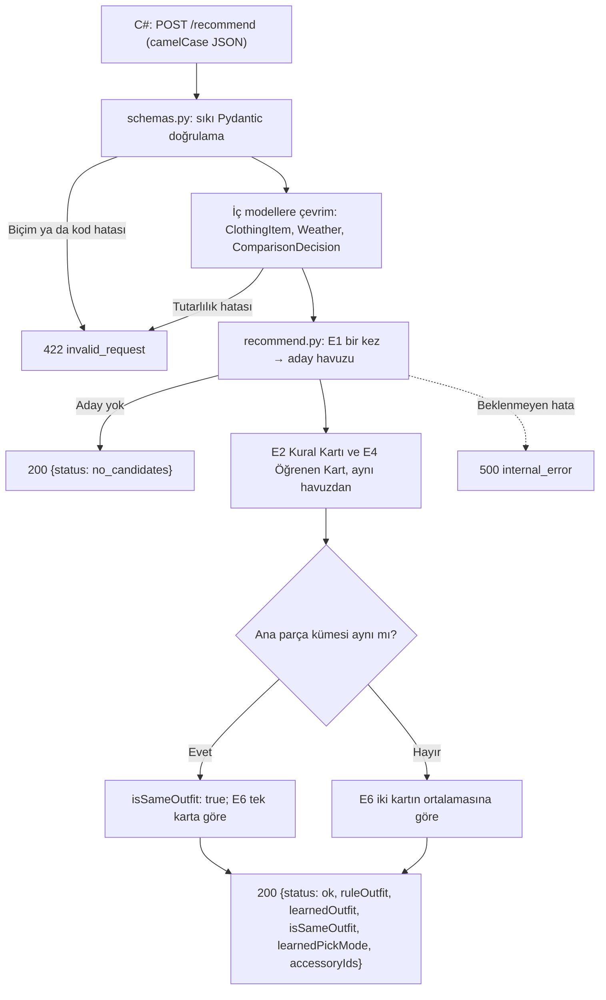

# E7 · `/recommend` ucu raporu

## Durum ve kapsam

E7'nin Python tarafı tamamlandı: `POST /recommend` A3 sözleşmesinin 6. bölümündeki istek
ve cevap biçimiyle çalışıyor, sözleşme örnekleriyle test edildi ve gerçek servis üzerinde
`curl` ile denendi. Uç, C#'ın kombin isteği (C5) ve "İkisi de olmaz" (C6) için iki kartı
birlikte üretir.

Genel plandaki "Karşılaştırma ekranında gerçek iki kart" ölçütü C# tarafına bağlıdır
ve 2. Aşama Planı'na göre 3. aşamada (C5, B8) karşılanır. `/swap` (E5) bu işe dahil değildir.

Uç, api deposundaki A3 sözleşmesine göre yazıldı. Sözleşme beş onayla sabitlendi (api PR #8,
#9) ve örnek dosyalar `tests/contracts/` kopyalarıyla birebir aynı. Sözleşme ilgili herkesin
onayıyla değişirse kopyalar, modeller ve testler birlikte güncellenir.

## İşleyiş



| Dosya | Görev |
| --- | --- |
| [recommendation/router.py](../recommendation/router.py) | Uç, hata biçimi, istek süresi logu. `service/main.py` bu dosyayı kendiliğinden bağlar |
| [recommendation/schemas.py](../recommendation/schemas.py) | camelCase modeller (`alias_generator=to_camel`, `populate_by_name=True`) ve iç modellere çevrim |
| [recommendation/recommend.py](../recommendation/recommend.py) | FastAPI'den bağımsız akış: E1 → E2 + E4 → E6 |
| [tests/contracts/](../tests/contracts/) | api deposundaki `contracts/examples/` kopyası (A3 PR #6, `049ce75`) |
| [tests/test_recommend.py](../tests/test_recommend.py) | Sözleşme, davranış ve hata testleri |

Akışın uçtan ayrı tutulması E5 `/swap`'ın aynı modelleri ve çevrimi kullanabilmesi, E10'un
ise akışı servis olmadan çağırabilmesi içindir.

## Sözleşmeyle eşleme

| Sözleşme | İç kod |
| --- | --- |
| Parça nesnesi (camelCase) | `ClothingItem` (alan alan aynı; kod doğrulaması `ClothingItem` içinde) |
| `context.feelsLikeTemp`, `weatherCondition` | `Weather` |
| `context.eventStyle` | E1 `style` |
| `context.isDaytime`, `wantsAccessories` | E6 `is_daytime`, `wants_accessories` |
| `rejectedOutfits` | E1 `rejected_outfits` (tekrar engeli) |
| `history[]` | `ComparisonDecision`; `comparisonId` `str()` ile metne, `user_id` istekteki `userId` |
| `ruleOutfit.itemIds`, `learnedOutfit.itemIds` | Kombinin ana parçaları, E1'in sırasıyla (üst, alt, ayakkabı, dış; tek parçada tek parça, ayakkabı, dış) |
| `learnedPickMode` | E4 `ogrenen_mode` (`soguk_baslangic`, `kesif`, `model`) |
| `accessoryIds` | E6 seçimi; istenmediyse ya da uygun aksesuar yoksa `[]` |

## Belirsizlikte seçilen yorumlar

Aşağıdakiler sözleşmede açıkça yazmayan noktalar için **seçilen yorumlardır**.

| Konu | Seçilen yorum | Gerekçe |
| --- | --- | --- |
| Modelin sıkılığı | Bilinmeyen alan reddedilir (`extra="forbid"`); türler sıkı (`"true"` metni ya da `"1"` metni kabul edilmez) | Sözleşme sabitlenecek; C# tarafındaki kaymanın birleştirme gününde sessizce yutulmak yerine logda görünmesi daha güvenli |
| Hata ayrımı | Biçim ve tutarlılık hataları çevrim aşamasında `422`; hesaplama sırasında çıkan her hata `500` | Kendi kodumuzdaki bir hatanın C#'a "senin isteğin bozuk" diye gitmemesi için |
| Tutarlılık denetimleri | Tekrarlı parça id'si, tekrarlı `comparisonId`, boş ya da tekrarlı `rejectedOutfits` listesi `422` | Bunlar E1/E4'te zaten hata; çevrimde yakalanınca doğru koda düşer |
| Dolapta onaylı olmayan parça | Reddedilmez; E1 ve E6 zaten yalnız `onayli` parçayı kullanır | Sözleşme dolaba yalnız onaylı gönderileceğini söylüyor; zararsız bir veri hatası kullanıcıya `502` olarak yansımasın |
| `timeOfDay` | Dört koddan biri olmalı, ama kullanılmaz; gündüz bilgisi `isDaytime`'dan alınır | Sözleşme `isDaytime`'ı aksesuar kuralının kaynağı olarak tanımlıyor; ikisinin tutarlılığı C#'ın sorumluluğu |
| `finalOutfit` alanı | Gönderilmezse `null` sayılır | Sözleşme "dolu, yoksa `null`" diyor; eksik alan aynı anlamda okunur |
| Rastgelelik | İstek başına yeni `random.Random()`; tek nesne sırayla E1, E2, E4 ve E6'ya verilir | Testlerde FastAPI bağımlılığı (`get_rng`) sabit tohumla değiştirilir; aynı tohum aynı cevabı verir |
| Hesaplama | İş parçacığı havuzunda (`run_in_threadpool`) | E4'ün her istekte eğitimi servis döngüsünü bloklamasın |

## Doğrulama sonuçları

Python 3.12 ile bütün paket (D7 dahil): **278 test geçti, 1 atlandı** (arka plan modeli testi). Bunların
**24'ü E7** testidir. E1–E6 kodu değiştirilmedi.

| Alan | Doğrulanan davranış |
| --- | --- |
| Sözleşme biçimi | `recommend-request.json` isteğinin cevabı `recommend-response.json` ile aynı anahtarlar ve türlerde; `-same-outfit` ve `-no-candidates` durumları; hata cevabı `error.json` ile birebir |
| Kartlar | Ana parçalarda aksesuar yok; `template` parçalara uygun; `isSameOutfit` iki kartın eşitliğiyle tutarlı |
| T-24 (Python kısmı) | Reddedilen kombin 10 farklı tohumda tekrar gelmiyor; hepsi reddedilince `no_candidates` |
| T-32 | 0 ve 9 kararlık geçmişle uç üzerinden `soguk_baslangic` |
| T-33 | 12 kararlık geçmişle 60 tohumda hem `kesif` hem `model` görülüyor |
| Aksesuar | Örnek bağlamda (9,4 °C, akşam) atkı #34; "28 °C, güneşli, öğle" elle verilen havasında şapka #35; `wantsAccessories: false` ile boş liste |
| Akış | E1 tek kez çağrılıyor; iki kart aynı havuzdan; aynı kombinde E6'ya tek kart gidiyor |
| `invalid_request` | `KS`, `OS`, `AT`, `BK`, `TP` ve bilinmeyen sonuç kodu; bilinmeyen alt tür, renk, durum, hava, etkinlik, vakit; kategori uyuşmazlığı; eksik, fazla ve yanlış türde alan; bozuk JSON; geçersiz UUID; tekrarlı id; E4'ün geçmiş kuralları (`OD`'de `finalOutfit`, saat dilimi) |
| `internal_error` | Hesaplamada beklenmeyen hata `500` ve sözleşmedeki mesaj; FastAPI `detail` biçimi hiç dönmüyor |

Testlerin davranışı gerçekten yakaladığını görmek için kod sekiz yerden bilerek bozuldu
(öğrenen kart ayrı havuzdan, aynı kombinde iki kart, red listesi iletilmiyor, sonuç kodu
denetimi yok, sıkı tür yok, fazla alan serbest, etkinlik denetimi yok, `isSameOutfit` hep
`false`); sekizi de en az bir testi kırdı.

### Gerçek servisle deneme

```bash
python -m uvicorn service.main:app --port 8765
curl -X POST http://127.0.0.1:8765/recommend -H 'Content-Type: application/json' \
  --data @tests/contracts/recommend-request.json
```

| İstek | Cevap |
| --- | --- |
| `GET /health` | `"modules": ["vision", "recommendation"]` |
| Sözleşme örneği | `200`, `ruleOutfit [2, 16, 19, 28]`, `learnedOutfit [5, 15, 19, 28]`, `isSameOutfit: false`, `learnedPickMode: soguk_baslangic`, `accessoryIds: [34]` |
| Aynı istek, 50 °C | `200 {"status": "no_candidates"}` |
| `{"userId": "x"}` | `422 invalid_request`: geçersiz UUID ve eksik alanlar mesajda |

Kart içerikleri rastgeleliğe bağlıdır; her çalıştırmada farklı olabilir. Sabit olan, biçim
ve kurallardır.

### Yeniden çalıştırma

```bash
python -m unittest discover -s tests -v
python -m unittest tests.test_recommend -v
```

## Sınırlılıklar

- Gövde elle doğrulandığı için FastAPI'nin otomatik belgesinde (`/docs`) istek şeması
  görünmez. Sözleşmenin kaynağı api deposundaki belge ve örneklerdir.
- `tests/contracts/` bir kopyadır; api deposundaki değişiklik otomatik gelmez.
- Pydantic `requirements.txt`'te ayrıca sabitlenmedi; FastAPI'nin bağımlılığı olarak 2.14.4
  kuruluyor.
- Süre ölçümü logda; 30 saniyelik C# sınırına karşı gerçek dolap ve uzun geçmişle ölçüm
  pilotta yapılmalı.

## Sonraki işler

- C5: C# tarafındaki Python istemcisiyle uçtan uca deneme.
- E5 `/swap`: aynı modeller ve E6'nın `rank_accessories` fonksiyonu.
- D8: README'deki `/recommend` deneme komutu çalıştırma belgesine bağlanır.
